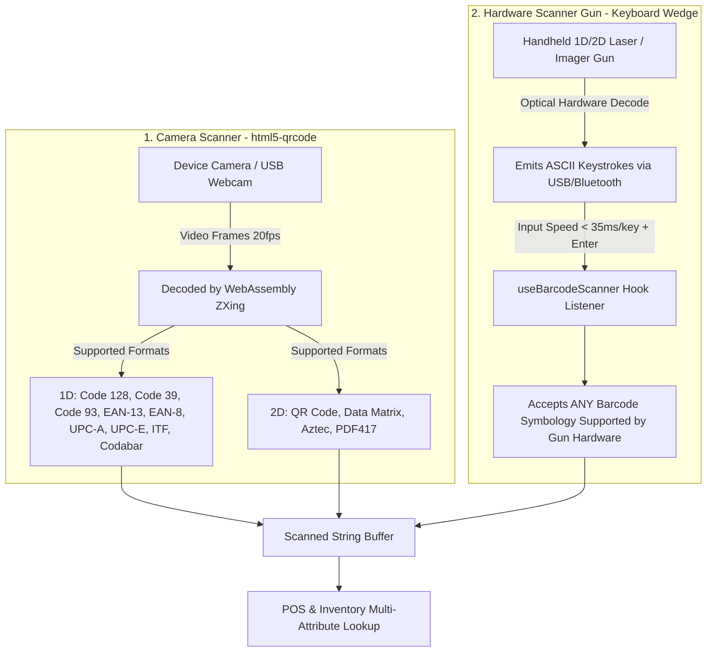
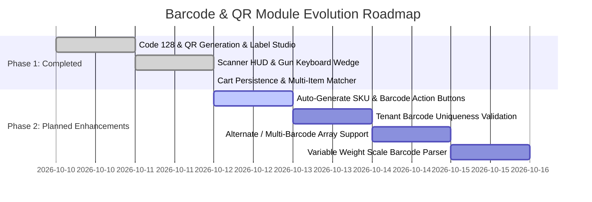

# Barcode & QR Code Architecture, Lifecycle & Edge Case Specification

## 1. Goal Description
The purpose of this document is to provide an authoritative, end-to-end technical specification of the **Barcode and QR Code Lifecycle** in QuickBill. It clarifies:
1. The exact barcode and QR code types generated and scanned (both optical and hardware wedge).
2. What happens when items lack barcode/SKU data, and how newly added codes interact with pre-printed labels.
3. How scanned data is captured, converted, and stored in MongoDB.
4. All edge cases already covered in the system.
5. Critical edge cases and enhancements remaining to be addressed.

---

## 2. Symbologies: What Types Are Scanned and Generated?

### 2.1. Code Generation (Printing & Export)
When printing thermal stickers (50x30mm, jewelry dumbbell tags, A4 sticker sheets) or downloading images:

| Symbology | Format | Library / Engine | Characteristics & Use Cases |
| :--- | :--- | :--- | :--- |
| **1D Barcode** | **Code 128 (Auto Subsets A/B/C)** | Web: `JsBarcode`<br>Backend: `reportlab.graphics.barcode.code128.Code128` | High-density linear barcode. Encodes all 128 ASCII characters (alphanumeric, dashes, punctuation). Best for standard thermal labels, retail shelves, and handheld 1D/2D laser scanners. |
| **2D Barcode** | **QR Code (ISO/IEC 18004, Model 2)** | Web: `qrcode`<br>Backend: `reportlab.graphics.barcode.qr.QrCodeWidget` | 2D matrix barcode with Error Correction (ECC Level M ~15%). Encodes structured URI/payload strings like `ITEM:itm_9f8a7b6c5d4e`. Best for camera scanning on mobile phones and compact jewelry dumbbell tags. |

### 2.2. Code Scanning
QuickBill supports two distinct scanning mechanisms:



1. **Integrated Web / Mobile Camera (`WebcamScannerModal`)**:
   - Decodes both 1D and 2D formats in real time.
   - Formats recognized: **Code 128, Code 39, Code 93, EAN-13, EAN-8, UPC-A, UPC-E, ITF, Codabar, QR Code, Data Matrix, Aztec, PDF417**.
2. **Physical Barcode / QR Guns (Handheld USB / 2.4GHz / Bluetooth)**:
   - Handheld guns perform the physical barcode recognition completely onboard within their optical sensors.
   - The gun behaves as an **HID Keyboard Wedge**, outputting the decoded character stream at high speed (<35ms per character) followed by `Enter`.
   - **Result**: The application accepts **ANY barcode symbology** the gun hardware is capable of reading (including GS1-128, ISBN, Japanese JAN, and industrial codes) without requiring browser changes.

---

## 3. Data Storage & Lifecycle: How Codes Are Stored & Generated

### 3.1. What Is Stored in MongoDB?
Barcode images are **never stored as raw image blobs** in the database. Instead, only clean string identifiers are stored.

```json
{
  "_id": ObjectId("6709b1f..."),
  "businessId": ObjectId("6709a0a..."),
  "name": "Organic Almond Milk 1L",
  "publicItemId": "itm_7a2b9c4d1e8f",
  "sku": "SKU-ALM-1L",
  "barcode": "8901030382910",
  "qrPayload": "ITEM:itm_7a2b9c4d1e8f",
  "salePrice": 180.00,
  "currentStock": 45.0
}
```

- **`publicItemId`**: An immutable, tenant-scoped unique ID generated on item creation (`itm_<hex>` or sequential `ITM-1001`). This ID never changes throughout the life of the product.
- **`qrPayload`**: Standardized format: `ITEM:<publicItemId>`.
- **`barcode`**: The manufacturer's barcode (e.g. EAN-13 / UPC) or an in-house barcode string.
- **`sku`**: Stock Keeping Unit (e.g. `GRO-MILK-001`).

### 3.2. What Happens if `barcode` or `sku` is Blank on Creation?
When creating an item without entering a Barcode or SKU:
1. MongoDB stores `barcode: null` (or `""`) and `sku: null`.
2. The server generates `publicItemId` (e.g., `itm_7a2b9c4d1e8f`).
3. If an initial label is printed before a barcode or SKU is assigned:
   - **QR Code Mode**: Encodes `ITEM:itm_7a2b9c4d1e8f`.
   - **1D Barcode Mode**: Encodes `itm_7a2b9c4d1e8f`.

### 3.3. What Happens if Admin Later Adds or Edits the Barcode / SKU?
If 500 stickers were printed using the initial code, and later the admin edits the item to add `barcode: "8901030382910"` and `sku: "SKU-ALM-1L"`:
- **Old Printed Labels Do Not Break**: Because the system matches items across all identifiers (`id`, `_id`, `publicItemId`, `sku`, `barcode`), scanning the old label (`itm_7a2b9c4d1e8f` or `ITEM:itm_7a2b9c4d1e8f`) **still finds the item**.
- **New Labels / Factory Packaging Also Work**: Scanning the manufacturer's barcode (`8901030382910`) or `SKU-ALM-1L` also finds the exact same item.
- Both identifiers coexist safely in the catalog.

---

## 4. Edge Cases Covered So Far

| # | Edge Case | How It Is Handled |
| :--- | :--- | :--- |
| 1 | **Fast Gun Input Dropping Characters** | `useBarcodeScanner` listens at the window level, tracking keystroke velocity (<45ms) so barcodes scanned from anywhere on the screen are caught even if the search input is not focused. |
| 2 | **Gun Enter Submitting Web Forms** | When a gun scans while cursor is inside an input field, `useBarcodeScanner` detects the rapid keystroke buffer and calls `e.preventDefault()` on `Enter` to prevent unintended modal or form submissions. |
| 3 | **Stale Closures in Camera Scanner** | Camera callback uses `isStandbyRef.current` and state references so continuous scans never close the modal unexpectedly. |
| 4 | **POS Refresh Discarding Cart (`F5`)** | Cart is persisted in `localStorage` (`qb_pos_cart`) and hydrated on mount. Location intervals are guarded so carts are not wiped on page load. |
| 5 | **Hardware Gun Repeat Debounce Lockout** | Hardware guns bypass the video frame debounce (`isHardwareTrigger = true`) so consecutive trigger pulls immediately increment item quantity (1 -> 2 -> 3). |
| 6 | **Item ID Discrepancies (`_id` vs `id`)** | The `isSameItem` multi-matcher checks `id`, `_id`, `publicItemId`, `sku`, and `barcode` (case-insensitively), preventing duplicate rows for the same product. |
| 7 | **Cross-Tenant Data Leakage** | QR lookups require authenticated tenant context (`get_current_business_id`). Looking up another tenant's QR code yields a clean `404 Not Found` without disclosing product or pricing data. |
| 8 | **Catalog Filter Masking Scanned Items** | Scans search the active filtered view with a fallback to `store.getRawItems()`, guaranteeing items are added even if filtered by category or search term. |

---

## 5. Critical Edge Cases & Remaining Gaps to Cover

### Gap 1: Auto-Generation of Sequential Barcodes & SKUs
- **Current State**: If the user leaves SKU/Barcode blank, they remain empty strings unless the user types one.
- **Risk**: Cashiers might have to print labels with random hex strings (`itm_3a8f...`) rather than clean retail codes (e.g., `SKU-10023` or standard 12-digit EAN-compatible codes).
- **Proposed Solution**:
  - Add an **"Auto-Generate"** magic-wand button next to SKU and Barcode inputs in the Item Form.
  - Generates standard clean formats: `SKU-<CATEGORY>-<SEQ>` and valid EAN/Code128 numeric codes.

### Gap 2: Barcode Uniqueness & Collision Enforcement
- **Current State**: Uniqueness is strictly indexed on `(businessId, publicItemId)` in MongoDB. If an admin accidentally enters the same barcode (`8901030382910`) for two different items, both might share the barcode.
- **Risk**: Scanning `8901030382910` at POS might add the wrong product if multiple items match.
- **Proposed Solution**:
  - Add a sparse unique compound index on `(businessId, barcode)` where `barcode != null && barcode != ""`.
  - Validate on item create/update, returning a 400 error: *"Barcode already assigned to product: [Product Name]"*.

### Gap 3: Alternate / Multiple Barcodes per Item (Pack vs Single / Packaging Changes)
- **Current State**: Items have a single `barcode` field.
- **Problem**: In retail, a product may have:
  - An individual piece barcode vs a 6-pack box barcode.
  - A manufacturer packaging revision where the barcode changed from EAN-A to EAN-B.
- **Proposed Solution**:
  - Support an optional `alternateBarcodes: string[]` field on the Item schema.
  - POS scanner and Inventory scanner checks both primary `barcode` and `alternateBarcodes`.

### Gap 4: Variable-Weight / Scale Barcodes (EAN-13 In-Store Prefixes 20-29)
- **Problem**: Supermarkets weighing produce (fruits, vegetables, meats) output printed barcodes starting with `20`, `21`, `22`, etc. (e.g. `20 00123 00450 C` where `00123` is Item ID and `00450` is weight 0.450 kg).
- **Proposed Solution**:
  - Add an option in Store Settings: *"Enable Scale / Variable Weight Barcode Parsing"*.
  - When prefix `20-29` is detected, parse the embedded item ID and weight/price automatically to set `quantity = weight`.

### Gap 5: Return / Invoice Receipt QR Scanning
- **Problem**: When a customer returns goods with a printed receipt, scanning the receipt QR code at POS should automatically load the original sale invoice for return/exchange.
- **Proposed Solution**:
  - Receipts print `INV:<invoiceNumber>` QR codes.
  - Scanner detects `INV:` prefix and opens the Invoice Details / Return dialog instead of searching product catalog.

---

## 6. Verification & Implementation Roadmap



### User Feedback Required
> [!IMPORTANT]
> Would you like to proceed immediately with implementing **Phase 2, Gap 1 & 2** (Auto-generation buttons for SKU & Barcode in the Add Product modal, and tenant-level barcode uniqueness checking in the backend)?
