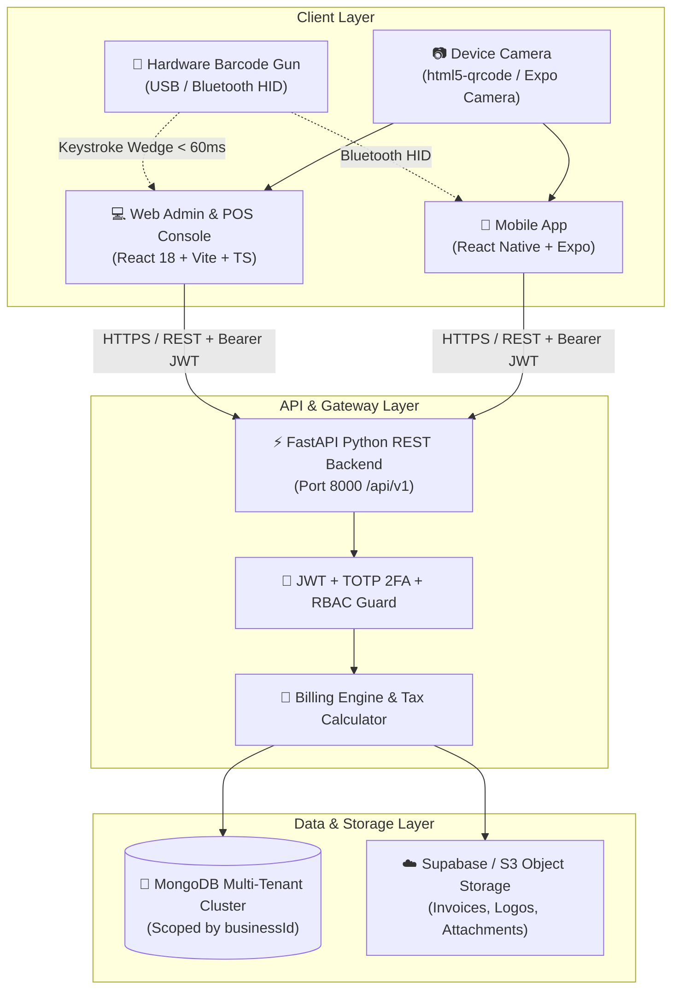
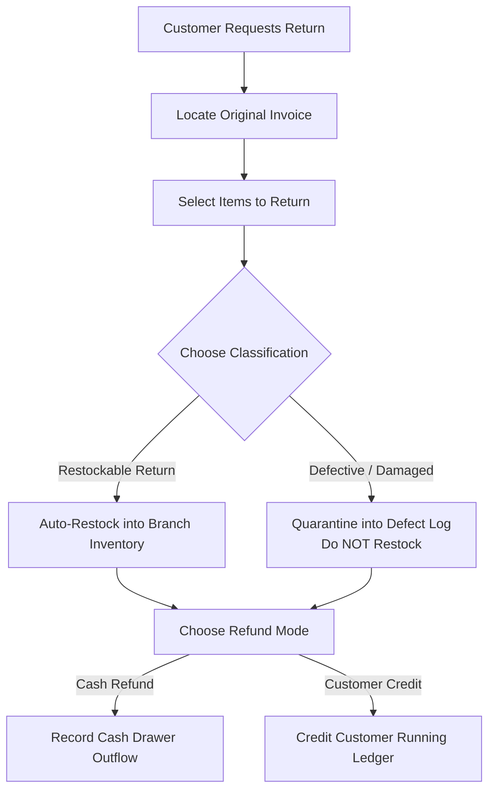

# ⚡ QuickBill — Enterprise Billing, Multi-Store Inventory & GST Accounting Platform

> **The complete, production-ready Point of Sale (POS), real-time inventory ledger, multi-store franchise management, and GST compliance system for Web and Mobile.**

[](https://fastapi.tiangolo.com)
[](https://vitejs.dev)
[](https://expo.dev)
[](https://www.mongodb.com)
[](https://www.typescriptlang.org)
[](https://www.python.org)

---

## 🧭 Essential Engineering & Operations Links

- 🛠️ **[Developer Startup & Contribution Guide (`DEVELOPER_STARTUP_GUIDE.md`)](DEVELOPER_STARTUP_GUIDE.md)**: Local setup, Docker MongoDB, FastAPI backend, Vite Web, Expo Mobile, standalone APK build runbooks, and test suites.
- 📖 **[End-User Operational Manual (`USER_GUIDE.md`)](USER_GUIDE.md)**: Daily operational guide for store managers, cashiers, and inventory clerks.
- 📋 **[Mobile vs. Web Feature Parity Plan (`MOBILE_VS_WEB_FEATURE_PARITY_AND_IMPROVEMENT_PLAN.md`)](MOBILE_VS_WEB_FEATURE_PARITY_AND_IMPROVEMENT_PLAN.md)**: Process alignment and feature parity roadmap.
- 🏛️ **[MongoDB Database Architecture & Schema Specification (`MONGODB_SCHEMA_AND_INTEGRATION_ARCHITECTURE.md`)](MONGODB_SCHEMA_AND_INTEGRATION_ARCHITECTURE.md)**: Collections, compound indexes, and ACID transaction rules.

---

## 📑 Master Table of Contents

1. [Executive Summary & Capabilities](#1-executive-summary--capabilities)
2. [System Architecture & Data Flow](#2-system-architecture--data-flow)
3. [User Roles & Personas Guide](#3-user-roles--personas-guide)
4. [Platform Comparison: Web Console vs. Mobile (Phone) App](#4-platform-comparison-web-console-vs-mobile-phone-app)
5. [Complete Feature Encyclopedia & Permutations](#5-complete-feature-encyclopedia--permutations)
   - [5.1. Authentication, 2FA & Multi-Branch Environment](#51-authentication-2fa--multi-branch-environment)
   - [5.2. Point of Sale (POS) Billing Engine](#52-point-of-sale-pos-billing-engine)
   - [5.3. Inventory Master, Branch Overrides & Barcode Studio](#53-inventory-master-branch-overrides--barcode-studio)
   - [5.4. Hardware Scanner Gun vs. Camera Scanner Protocols](#54-hardware-scanner-gun-vs-camera-scanner-protocols)
   - [5.5. Sales Returns, Defect Auditing & Restocking](#55-sales-returns-defect-auditing--restocking)
   - [5.6. Customer Khata, Supplier Payables & Dual-Party Ledger](#56-customer-khata-supplier-payables--dual-party-ledger)
   - [5.7. Purchase Orders & Stock Inwarding Workflow](#57-purchase-orders--stock-inwarding-workflow)
   - [5.8. Shipping, Packing & Dispatch Desk](#58-shipping-packing--dispatch-desk)
   - [5.9. Financial Reports, Day Book, Profit & Loss, and GSTR-1](#59-financial-reports-day-book-profit--loss-and-gstr-1)
6. [Real-World Business Use Cases & Operational Scenarios](#6-real-world-business-use-cases--operational-scenarios)
   - [6.1. Scenario 1: High-Velocity Supermarket Rush-Hour Checkout](#61-scenario-1-high-velocity-supermarket-rush-hour-checkout)
   - [6.2. Scenario 2: Wholesale B2B Distributor & Khata Credit Account](#62-scenario-2-wholesale-b2b-distributor--khata-credit-account)
   - [6.3. Scenario 3: Multi-Branch Franchise with Airport vs. City Pricing](#63-scenario-3-multi-branch-franchise-with-airport-vs-city-pricing)
   - [6.4. Scenario 4: Jewelry & Optical Tagging with Barcode Studio](#64-scenario-4-jewelry--optical-tagging-with-barcode-studio)
   - [6.5. Scenario 5: Itemized Sales Return & Defect Quarantine Audit](#65-scenario-5-itemized-sales-return--defect-quarantine-audit)
   - [6.6. Scenario 6: End-of-Day Register Closing & GSTR-1 Tax Audit](#66-scenario-6-end-of-day-register-closing--gstr-1-tax-audit)
   - [6.7. Scenario 7: Quick-Serve Food & Express Café Billing with Cash Round-Off](#67-scenario-7-quick-serve-food--express-café-billing-with-cash-round-off)
   - [6.8. Scenario 8: Electronics & Hardware Store Serial/IMEI Tracking & Warranty Audit](#68-scenario-8-electronics--hardware-store-serialimei-tracking--warranty-audit)
   - [6.9. Scenario 9: Pharmacy & Medical Store Batch, Expiry Date & HSN 3004 Compliance](#69-scenario-9-pharmacy--medical-store-batch-expiry-date--hsn-3004-compliance)
   - [6.10. Scenario 10: Central Warehouse Inwarding & Inter-Branch Stock Transfers](#610-scenario-10-central-warehouse-inwarding--inter-branch-stock-transfers)
7. [Core Technical Implementations & Code Blueprints](#7-core-technical-implementations--code-blueprints)
   - [7.1. Reverse Tax-Inclusive Calculation Engine](#71-reverse-tax-inclusive-calculation-engine)
   - [7.2. Immutable Stock Ledger & Multi-Document ACID Transactions](#72-immutable-stock-ledger--multi-document-acid-transactions)
   - [7.3. Multi-Tenant Scoping Middleware & IDOR Defense](#73-multi-tenant-scoping-middleware--idor-defense)
   - [7.4. Hardware Scanner Gun (<60ms HID Wedge) Interceptor](#74-hardware-scanner-gun-60ms-hid-wedge-interceptor)
   - [7.5. Parked Cart Conflict Resolution Protocol](#75-parked-cart-conflict-resolution-protocol)
   - [7.6. Mobile Dynamic Keyboard Inset & Scroll Engine](#76-mobile-dynamic-keyboard-inset--scroll-engine)
   - [7.7. Real-Time Cashier Shift Day-Book & Float Reconciliation Engine](#77-real-time-cashier-shift-day-book--float-reconciliation-engine)
   - [7.8. High-Performance Offline Sync & Optimistic Mutation Queue](#78-high-performance-offline-sync--optimistic-mutation-queue)
   - [7.9. Dynamic Barcode Label Generation & Millimeter-Accurate Sheet Printing Engine](#79-dynamic-barcode-label-generation--millimeter-accurate-sheet-printing-engine)
   - [7.10. Interstate IGST vs Intra-State CGST/SGST Tax Engine](#710-interstate-igst-vs-intra-state-cgstsgst-tax-engine)
8. [Keyboard Shortcuts Cheatsheet (Web POS)](#8-keyboard-shortcuts-cheatsheet-web-pos)
9. [Quickstart & Local Development Runbook](#9-quickstart--local-development-runbook)
10. [Environment Variables Reference](#10-environment-variables-reference)
11. [Troubleshooting & Frequently Asked Questions (FAQ)](#11-troubleshooting--frequently-asked-questions-faq)

---

## 1. Executive Summary & Capabilities

QuickBill is an omni-channel retail and wholesale operating system designed to bridge the gap between heavy desktop ERP software and modern, high-speed mobile billing. Built with a unified backend, it powers both a rich desktop **Web Console** for desktop computers/laptops and a native **Mobile App** for smartphones and tablets.

### 🌟 Core Value Pillars
- **⚡ Sub-15-Second Billing Velocity**: Rapid catalog lookup, category popovers, global keyboard shortcuts, and zero-latency barcode scanning.
- **🛡️ Strict Multi-Tenant Data Isolation**: Logical data partition per tenant (`businessId`) enforcing zero cross-tenant data leakage.
- **🏪 Location & Franchise Scoping**: Universal master catalog with location-specific (`locationId`) stock counts, custom pricing overrides, and local GSTIN receipts.
- **📦 Immutable Stock Movement Ledger**: Complete audit trail for every addition, sale, return, damage, and adjustment without destructive overwrite updates.
- **🏷️ Hardware Barcode Gun & Camera Viewfinder**: Plug-and-play support for physical 1D/2D USB, 2.4G wireless dongles, and Bluetooth scanner guns alongside smartphone camera scanning.
- **📊 Authoritative Financial Engine**: Tax-inclusive reverse calculations, output GST segregation, true catalog Cost of Goods Sold (COGS), and GSTR-1 rate slab breakdowns (0%, 5%, 12%, 18%, 28%).

---

## 2. System Architecture & Data Flow



---

## 3. User Roles & Personas Guide

QuickBill implements strict Role-Based Access Control (RBAC). Every staff account is assigned a specific role that dictates accessible views, modification permissions, and reporting scope.

| Persona / Role | Target Users | Primary Responsibilities | Permitted Capabilities & Views |
| :--- | :--- | :--- | :--- |
| **👑 Business Owner / Tenant Admin** (`TENANT_ADMIN`) | Store Owners, Managing Directors, Franchise Operators | Complete business stewardship, governance, and strategy. | • Full access to all stores and branches.<br/>• Create and manage staff accounts and role assignments.<br/>• View all Financial Reports (Day Book, Trading & P&L, GSTR-1).<br/>• Configure company profile, GSTIN, receipt footers, and 2FA.<br/>• Manage branch locations and tenant settings. |
| **💼 Store & Inventory Manager** (`MANAGER`) | Store Managers, Stock Supervisors, Head Cashiers | Stock integrity, warehouse operations, and staff coordination. | • Manage product master data, categories, and units.<br/>• Perform stock adjustments (Surplus, Damage, Loss, Inward).<br/>• Manage Supplier Purchase Orders & receive inward shipments.<br/>• Authorize Sales Returns & audit restockable vs. damaged goods.<br/>• Configure customer credit limits and view customer khata ledgers.<br/>• Override branch-specific selling prices and discounts. |
| **⚡ Cashier / Billing Staff** (`CASHIER`) | Checkout Operators, Counter Clerks, Floor Cashiers | High-velocity point-of-sale customer billing. | • Fast POS checkout and barcode scanning.<br/>• Hold and resume in-flight customer carts (Parked Orders).<br/>• Collect payments (Cash, UPI, Card, Split, Credit Khata).<br/>• Print 2"/3" thermal receipts and share via WhatsApp.<br/>• Register new walk-in customers during checkout.<br/>• View active location catalog and stock indicators.<br/>*(Restricted from editing master item costs, deleting invoices, or viewing store P&L).* |
| **📊 Accountant / Auditor** (`ACCOUNTANT`) | Internal Accountants, External GST Auditors, Bookkeepers | Financial reconciliation, tax auditing, and compliance filing. | • Full access to Trading & Profit & Loss statements.<br/>• Export GSTR-1 Rate Slab reports (0%, 5%, 12%, 18%, 28%).<br/>• Audit customer & supplier running ledgers and Day Book.<br/>• Export transaction data and ledger statements to CSV/PDF.<br/>*(View-only access to POS and inventory adjustments).* |
| **📦 Dispatch & Shipping Clerk** (`DISPATCHER`) | Order Fulfillment Staff, Packing Desk Personnel | Package verification, label printing, and courier dispatch. | • Access Shipping & Dispatch Desk.<br/>• Verify packed items by barcode scanner.<br/>• Assign AWB tracking numbers and dispatch carriers.<br/>• Print thermal shipping box labels and packing slips. |
| **🌐 Platform Super Admin** (`SUPER_ADMIN`) | QuickBill SaaS Operations, DevOps Engineers | Multi-tenant platform provisioning and platform health. | • Provision new tenant workspaces (`businessId`).<br/>• Monitor platform database metrics and API health.<br/>• Manage subscription tiers, limits, and system migrations. |

---

## 4. Platform Comparison: Web Console vs. Mobile (Phone) App

QuickBill is engineered as a unified dual-surface ecosystem. Both interfaces synchronize in real time against the central database while offering form-factor-optimized workflows.

| Feature / Capability | 💻 Web Admin & POS Console (`apps/web`) | 📱 Mobile Smartphone App (`apps/mobile`) | Key Permutations & Notes |
| :--- | :---: | :---: | :--- |
| **Form Factor Optimization** | Desktop, Laptop, Dual-Screen POS Terminals | Android & iOS Smartphones, Handheld POS | Web has full widescreen layout; Mobile is pocket-sized and portrait-optimized. |
| **POS Checkout Velocity** | ⚡ Sub-10s with keyboard shortcuts (`F2`, `F8`, `F9`) | ⚡ Sub-15s with touch + instant camera scan | Web allows hands-free keyboard operation; Mobile allows on-the-move floor billing. |
| **Barcode / QR Scanning** | • **Hardware Gun (Primary)**: USB / 2.4G / Bluetooth<br/>• **Webcam Viewfinder**: Built-in/External camera | • **Hardware Gun (Primary)**: Bluetooth / USB-C OTG<br/>• **Native Camera**: Instant rear camera autofocus | In both platforms, hardware scanner guns take precedence and do **not** trigger camera permissions. |
| **Cart Staging (Parked Orders)** | ✅ Yes (`F8` key, multiple simultaneous held carts) | ✅ Yes (Held carts list in POS switcher) | Staged carts synchronize with the server and survive app restarts and tab reloads. |
| **Receipt Printing** | • Thermal POS (2-inch 58mm & 3-inch 80mm)<br/>• Full-page A4 Tax Invoice PDF | • Mobile Thermal Bluetooth / Wi-Fi POS<br/>• Direct PDF generation | Web connects to raw browser print/ESC-POS; Mobile utilizes native Expo Print. |
| **Digital Share Sheet** | • Direct WhatsApp Web / Desktop API link | • Native iOS / Android Share Sheet (WhatsApp, SMS, Email) | Mobile opens WhatsApp directly with formatted message and receipt. |
| **Product Master & Editing** | ✅ Master catalog + Branch pricing/stock overrides | ✅ Master catalog view, item creation & edit | Web allows editing location-specific discount & list status; Mobile edits core attributes. |
| **Barcode Label Studio** | ✅ Yes (Thermal 50x30mm, Dumbbell, A4 Sheets) | ⚡ Yes (Mobile Thermal Label Preview) | Web offers multi-column laser sticker sheet generation. |
| **Sales Returns & Defect Audit**| ✅ Full & partial returns with defect quarantine | ✅ Full & partial returns with reason tags | Automatically restores `RESTOCKABLE` to inventory; isolates `DEFECTIVE` items. |
| **Party Khata & Ledgers** | ✅ Customer receivables, supplier payables, PDF statements | ✅ Customer receivables, supplier payables, Payment In/Out | Full running balance statement with debit/credit balance indicators. |
| **Purchase Order Management** | ✅ Complete PO workflow, bill linking & stock inwarding | ✅ Purchase Orders list & basic stock inwarding | Updates supplier payables and inventory movements in real time. |
| **Shipping & Dispatch Desk** | ✅ Dedicated barcode verification & AWB tracking | 📋 Roadmap feature | Designed for wholesale packing and fulfillment teams. |
| **Financial & GST Analytics** | ✅ Comprehensive Day Book, Trading & P&L, GSTR-1, COGS | ✅ KPI Dashboard, Sales Day Book summary | Web provides deep accounting breakdowns and CSV data exports. |
| **Two-Factor Authentication** | ✅ Setup & QR scanning for TOTP authenticators | ✅ Authenticator code entry upon login | Secures access to reports, branch deletion, and user role updates. |

---

## 5. Complete Feature Encyclopedia & Permutations

### 5.1. Authentication, 2FA & Multi-Branch Environment

QuickBill ensures end-to-end security through modern cryptographic hashing and granular tenancy scoping.

#### 1. Login & Token Lifecycle
- **Work Email & Password**: Authenticates against the server using Argon2/bcrypt password hashing.
- **JWT Architecture**: Issues a short-lived access token along with an automatic refresh mechanism.
- **Server URL Binding**: Mobile and Web clients connect to the authoritative cloud backend (`https://quick-bill-alpha.vercel.app/api/v1`) without manual host input.
- **Keyboard Resilience (Mobile)**: Login views dynamically adapt when the virtual keyboard opens, auto-scrolling to the active input and allowing instant tap-to-dismiss.

#### 2. Two-Factor Authentication (2FA / TOTP)
- **Time-Based One-Time Password**: Compatible with Google Authenticator, Microsoft Authenticator, and Authy.
- **Recovery Codes**: Generates cryptographic one-time backup recovery codes during setup.
- **Enforcement**: Required for elevated operations including branch deletion, financial report exports, and staff role reassignment.

#### 3. Multi-Store & Branch Switching
- **Universal Top Bar Selector**: Switch between branches (e.g., *Downtown Retail Store*, *Suburban Warehouse*, *Express Kiosk*) instantly.
- **Automatic Scoping**: Once a branch is selected, all POS billing, inventory counts, stock adjustments, and day books immediately scope to that `locationId`.
- **Branch Profile Customization**: Each branch maintains independent legal parameters:
  - Branch Display Name
  - State & Local GSTIN
  - Store Code (e.g., `BLR-01`, `MUM-02`)
  - Contact Phone & Street Address
  - Custom Thermal Receipt Header and Footer Policy Notice

---

### 5.2. Point of Sale (POS) Billing Engine

The QuickBill billing engine is built around a server-authoritative calculation pipeline designed for fast retail and wholesale environments.

```text
┌─────────────────────────────────────────────────────────────────────────────┐
│ 1. ADD PRODUCTS: Barcode Gun / Camera / Instant Search / Category Popover    │
│ 2. QUANTITY ADJUSTMENTS: Decimal (1.5 kg) or Whole Units (2 pcs)            │
│ 3. DISCOUNTS: Line-Item (% or ₹)  +  Bill-Level Overall Discount            │
│ 4. TAX REVERSE COMPUTATION: Shelf Price -> Taxable Base + Output CGST/SGST  │
│ 5. HOLD / RESUME CARTS: Parked Order Synchronization                        │
│ 6. PAYMENT COLLECTION: Cash, UPI, Card, Net Banking, Split, or Khata Credit │
│ 7. SETTLEMENT & PRINT: Thermal 2"/3" Receipt + WhatsApp Share + Ledger Entry │
└─────────────────────────────────────────────────────────────────────────────┘
```

#### Permutations of Adding Products to Cart:
1. **Hardware Barcode Scanner Gun (Fastest)**: Scan any 1D barcode (EAN-13, Code 128) or 2D QR code. The item is added immediately; scanning again increments quantity without creating duplicate lines.
2. **Device Camera Scanner**: For smartphone floor billing, activate the camera viewfinder to scan items hands-free.
3. **Instant Search Box (`F2`)**: Type product name, SKU, or public item ID. Auto-focus and instant search filtering.
4. **Visual Category Catalog**: Click the Category popover to filter products by category badges (e.g., *Groceries*, *Dairy*, *Beverages*).

#### Pricing & Tax Computation Permutations:
- **Tax-Inclusive Pricing (Retail MRP)**: Product prices on the shelf are customer-facing total prices. The system automatically computes the taxable base:
  $$\text{Taxable Base} = \frac{\text{Selling Price}}{1 + \text{GST Rate}}$$
  $$\text{Output Tax} = \text{Selling Price} - \text{Taxable Base}$$
  *(For an item priced at ₹118.00 with 18% GST: Taxable Base = ₹100.00, Output CGST = ₹9.00, Output SGST = ₹9.00).*
- **Fractional / Decimal Quantities**: Products configured with `allowParts: true` accept decimal quantities (e.g., `1.750` kg of grain, `0.500` L of oil) with accurate pro-rata total calculations.

#### Discount Permutations:
- **Line-Item Discounts**: Apply percentage (`%`) or flat (`₹`) discounts to individual rows.
- **Bill-Level Overall Discounts**: Apply an overall discount to the entire invoice summary.
- **Zero Subtotal Guard**: Discounts can never exceed item or invoice subtotals.

#### Cart Staging & Parked Orders:
- **Park Cart (`F8`)**: When a customer leaves the queue to pick up another item, park the cart with one keystroke.
- **Cloud Synchronization**: Parked orders are saved to the backend database with conflict resolution, allowing a different POS terminal to resume the cart.
- **Discard Confirmation**: Safety confirmation modals prevent accidental loss of staged orders.

#### Payment Processing Permutations:
- **Cash**: Direct cash tender with real-time change calculation.
- **UPI / Dynamic QR**: Generates dynamic UPI QR codes containing invoice total and store UPI VPA for customer mobile scanning.
- **Credit / Debit Card**: Records authorization transaction reference numbers.
- **Customer Credit (Khata Due)**: Sells items on credit to registered parties, enforcing customer credit limits and posting a debit to their running ledger.
- **Split Payments**: Collect partial amounts across multiple modes (e.g., *₹500.00 Cash + ₹750.00 UPI*).

#### Receipts & Sharing:
- **Thermal POS Print**: Compact 2-inch (58mm) and 3-inch (80mm) receipts with store branding, GST breakdown table, and custom footer.
- **A4 Tax Invoice**: Full-page official tax invoice suitable for B2B transactions.
- **WhatsApp Direct Sharing**: Sends pre-formatted receipt details and a download link directly to the customer's phone number without saving their contact.

---

### 5.3. Inventory Master, Branch Overrides & Barcode Studio

#### 1. Product Master Data Attributes
- **Product Name**: Full descriptive title.
- **SKU Code**: Unique Stock Keeping Unit (e.g., `INT-SKU-GRO-8421`) with one-click auto-generation.
- **Barcode Number**: 1D EAN/UPC or Code 128 string with auto-generation and duplicate collision alerts.
- **Category & Unit**: Categorized hierarchy with units (`pcs`, `kg`, `g`, `ltr`, `box`).
- **GST Rate**: Configurable standard rate slabs (`0%`, `5%`, `12%`, `18%`, `28%`).
- **Fractional Sales Toggle**: Enable/disable decimal quantities during billing.

#### 2. Multi-Branch Overrides
Each item exists globally across the business catalog but supports branch-level overrides:
- **Location Selling Price**: Set higher or lower retail prices at premium airport/mall branches vs. suburban stores.
- **Branch Stock Counts**: Track independent current stock counts per branch.
- **Location Discount Policies**: Activate branch-specific percentage or flat discounts.
- **Branch Listing Toggle**: Exclude specific items from being sold or visible at designated branches.

#### 3. Stock Adjustments & Movement Audit
Stock adjustments require a classified operational reason:
- `SURPLUS`: Physical count surplus / stock found during auditing.
- `DAMAGE`: Damaged or defective goods written off.
- `LOSS`: Shrinkage, theft, or unexplained discrepancy.
- `INWARD`: Manual stock intake outside standard purchase orders.
- *Every adjustment writes an immutable record to `inventory_movements` preserving previous stock, delta, resulting stock, staff ID, and timestamp.*

#### 4. Barcode & QR Label Printing Studio
- **Thermal Sticker (50x30mm)**: Standard retail tag featuring store name, item title, Code 128 barcode or 2D QR code (`ITEM:<publicItemId>`), human-readable SKU, and bold MRP/Sale Price.
- **Jewelry Dumbbell Tag (70x12mm)**: Dual-flap micro tag designed for jewelry, optical frames, and small accessories.
- **A4 Sticker Sheets**: Multi-column grids (24 / 40 labels per sheet) for standard desktop laser and inkjet printers.

---

### 5.4. Hardware Scanner Gun vs. Camera Scanner Protocols

QuickBill supports both industrial handheld scanner guns and device cameras.

```text
┌─────────────────────────────────────────────────────────────────────────────┐
│                    BARCODE & QR CODE SCANNING STRATEGY                      │
├──────────────────────────────────────┬──────────────────────────────────────┤
│ 💻 LAPTOP / DESKTOP (Web Console)    │ 📱 SMARTPHONE (Mobile App)           │
├──────────────────────────────────────┼──────────────────────────────────────┤
│ • Primary: Hardware Scanner Gun      │ • Primary: Hardware Scanner Gun      │
│ • Zero camera popups by default      │ • Zero camera permissions on open    │
│ • High-speed HID wedge (<60ms)       │ • Bluetooth / USB-C OTG input        │
│ • Auto-focused input field           │ • Prominent "Switch to Camera" tab   │
│ • Camera toggle tab for webcam       │ • Camera viewfinder on demand        │
└──────────────────────────────────────┴──────────────────────────────────────┘
```

#### Key Architecture Principles:
1. **Hardware Gun Priority**: When clicking "Scan" on SKU or Barcode fields (in *Add New Product* or *Edit Product & Branch Settings*), the system **defaults to the Barcode Scanner Gun input mode**. It does **not** activate the camera or prompt for webcam permissions.
2. **Superhuman Keystroke Interceptor**: Hardware guns act as rapid HID keyboard wedges emitting characters under 60ms apart followed by an `Enter` key. The application captures these keystrokes globally without requiring manual focus on specific inputs.
3. **Camera Toggle Option**: For smartphone or tablet operators who lack a physical scanner gun, a clear button (`📷 Switch to Camera Scanner`) allows activating the camera on demand.

---

### 5.5. Sales Returns, Defect Auditing & Restocking

QuickBill provides a complete sales return and defect auditing pipeline:



#### Return Permutations:
- **Full Invoice Return**: Returns all line items in a single click.
- **Partial Itemized Return**: Select individual items and specify return quantities.
- **Reason Classification**:
  - `RESTOCKABLE_RETURN`: Good condition goods. The system immediately increments branch inventory and logs a restock movement.
  - `DEFECTIVE_DAMAGED`: Damaged goods. The system prevents restocking, records the defect description, and logs the write-off for supplier replacement.
- **Settlement Method**: Issue an instant cash refund or generate a credit note posted to the customer's khata account.

---

### 5.6. Customer Khata, Supplier Payables & Dual-Party Ledger

Manage B2B credit accounts and customer khata books with complete financial fidelity.

#### Customer Khata Capabilities:
- **Credit Limit Enforcement**: Configure maximum allowable credit limits. The POS blocks credit sales if the limit is exceeded without manager authorization.
- **Running Ledger Balance**: Displays real-time balances (*You Will Get / Receivables*).
- **Payment In**: Record customer payments against outstanding balances with payment mode (Cash, Bank, UPI) and notes.
- **Account Statements**: Print or export detailed running account statements with invoice numbers, payment dates, debit, credit, and running balance.

#### Supplier Payables Capabilities:
- **Payables Tracking**: Displays pending balances (*You Will Give / Payables*).
- **Payment Out**: Record supplier payments against purchase orders with reference numbers.
- **Purchase Ledger History**: Complete ledger of purchases, debit notes, and payments.

---

### 5.7. Purchase Orders & Stock Inwarding Workflow

1. **Select Supplier**: Choose an existing supplier or add a new supplier profile on the fly.
2. **Add Products & Costing**: Select catalog items; enter supplier purchase price, tax rate, and inward quantity.
3. **Reference Linking**: Enter supplier invoice/challan number and date.
4. **Post Purchase**:
   - Branch stock levels increase immediately.
   - An inward movement is recorded in the immutable inventory ledger.
   - The supplier's payable ledger balance updates automatically.

---

### 5.8. Shipping, Packing & Dispatch Desk

Built for wholesale and multi-channel fulfillment operations:
- **Fulfillment Queue**: View pending orders ready for packing and shipping.
- **Barcode Packing Verification**: Warehouse staff scan each item barcode before sealing boxes, ensuring zero packing errors.
- **Air Waybill (AWB) Allocation**: Assign courier partners (e.g., *BlueDart*, *Delhivery*, *FedEx*) and tracking numbers.
- **Thermal Shipping Labels**: Print shipping box labels with barcode tracking and customer destination addresses.

---

### 5.9. Financial Reports, Day Book, Profit & Loss, and GSTR-1

QuickBill features an authoritative business intelligence reporting suite:

#### 1. Daily Day Book
- Real-time audit of daily store turnover.
- Segregated totals: **Cash Drawer**, **UPI / Digital**, **Card**, and **Customer Credit / Due**.
- Cash flow reconciliation between opening balance, sales, expenses, and closing cash.

#### 2. Trading & Profit & Loss Statement (True Catalog COGS)
- **Gross Sales Turnover**: Net revenue after line-item and bill-level discounts.
- **Output Tax Segregation**: Output GST is separated from revenue to prevent double-tax deductions.
- **True Cost of Goods Sold (COGS)**: Back-calculated using authoritative product purchase prices recorded at the time of purchase.
- **Gross Profit & Operating Expenses**: Net operating profit computed after factoring in staff, rent, utility, and maintenance expenses.

#### 3. GSTR-1 GST Rate Slab Report
- Automatic breakdown of turnover across standard statutory rate slabs:
  - **0% Excluded / Nil-Rated**
  - **5% GST** (2.5% CGST + 2.5% SGST)
  - **12% GST** (6.0% CGST + 6.0% SGST)
  - **18% GST** (9.0% CGST + 9.0% SGST)
  - **28% GST** (14.0% CGST + 14.0% SGST)
- Formatted for direct entry into official GST portal filings or CSV export for tax consultants.

#### 4. Stock Valuation Report
- Real-time warehouse valuation at cost price vs. potential retail valuation at shelf sale price.
- Identification of slow-moving and dead stock capital.

---

## 6. Real-World Business Use Cases & Operational Scenarios

### 6.1. Scenario 1: High-Velocity Supermarket Rush-Hour Checkout

**The Context**: A grocery store with 15 customers in line. Speed is critical.
1. **Barcode Gun Ingestion**: The cashier scans items using a USB handheld scanner gun. Items pop into the active bill in `<200ms`.
2. **Decimal Weighing Scale Item**: A customer has 1.85 kg of Basmati Rice. The cashier clicks the quantity or types `1.85`. With `allowParts: true`, the system computes the exact price ($1.85 \times ₹110.00 = ₹203.50$).
3. **Queue Obstruction (Park Cart)**: The customer realizes they forgot eggs and runs back to the aisle. Rather than cancelling the bill, the cashier presses `F8` (**Park Cart**). The cart is saved to the cloud, and the counter immediately begins billing the next customer.
4. **Resume & Payment Split**: When the customer returns, the cashier clicks **Held Carts**, resumes order `#104`, adds eggs, and presses `F9`. Total bill: `₹1,240.00`. The customer pays `₹500.00 in Cash` and scans the dynamic UPI QR code for the remaining `₹740.00`.
5. **Instant Receipt**: A 3-inch thermal slip prints via browser print in under 1 second, and the cashier enters the customer's phone to send the WhatsApp e-receipt.

---

### 6.2. Scenario 2: Wholesale B2B Distributor & Khata Credit Account

**The Context**: A distributor supplying 50 cartons of FMCG goods to a neighborhood retailer (*Krishna Traders*).
1. **Selecting Credit Party**: The billing clerk searches for *Krishna Traders* in the customer selector. The system displays: `Credit Limit: ₹1,00,000` | `Current Balance Due: ₹45,200`.
2. **Drafting Invoice**: 50 cartons are added at wholesale rates with an invoice-level 3% trade discount. Total: `₹38,000`.
3. **Credit Limit Check**: The system validates:
   $$\text{New Outstanding} = ₹45,200 + ₹38,000 = ₹83,200 \le ₹1,00,000$$
   The credit check passes without requiring manager override.
4. **Settlement**: Tender mode is set to **Customer Credit (Due)**. Stock decreases by 50 cartons immediately.
5. **Payment In Collection**: Two days later, Krishna Traders pays `₹50,000 via NEFT`. The clerk opens **Parties $\rightarrow$ Krishna Traders $\rightarrow$ Record Payment In**, enters the bank reference number, and the balance automatically updates to `₹33,200`.

---

### 6.3. Scenario 3: Multi-Branch Franchise with Airport vs. City Pricing

**The Context**: An organic coffee chain with a flagship branch in Downtown and a premium kiosk at the International Airport.
1. **Central Master Catalog**: An item *Organic Cold Brew 500ml* is created once in the master catalog with Base MRP `₹150.00` and Purchase Cost `₹60.00`.
2. **Airport Price Override**: In **Inventory $\rightarrow$ Edit Product & Branch Settings**, the manager selects the Airport branch and sets:
   - Selling Price: `₹220.00` (Airport premium)
   - Stock: `85 pcs`
3. **Downtown City Override**:
   - Selling Price: `₹150.00`
   - Active Promotional Discount: `10% Flat`
   - Stock: `320 pcs`
4. **Automatic Counter Scoping**: When a cashier logs into the Airport terminal, the item scans at `₹220.00`. At the Downtown counter, it scans at `₹135.00` (after 10% discount). Master inventory ledger remains clean and partitioned per `locationId`.

---

### 6.4. Scenario 4: Jewelry & Optical Tagging with Barcode Studio

**The Context**: A boutique jewelry shop needs barcode labels for 200 handmade silver rings.
1. **Creating Item**: The jeweler creates *925 Sterling Silver Band Ring* and clicks `⚡ Auto-Generate Barcode`. A unique Code 128 string (`INT-894102`) is assigned.
2. **Barcode Studio**: The jeweler clicks **Print Labels**, selects **Jewelry Dumbbell Tag (70x12mm)**, and enters `200 copies`.
3. **Thermal Tag Layout**: The system renders the dual-flap layout with micro-barcode and store brand on the left flap, and net weight (`3.4g`) and price (`₹1,850.00`) on the right flap.
4. **POS Hardware Ingestion**: When sold, the cashier points the red laser of their desktop scanner gun at the dumbbell tag. The gun wedge catches `INT-894102` and immediately adds the ring to the bill.

---

### 6.5. Scenario 5: Itemized Sales Return & Defect Quarantine Audit

**The Context**: A customer returns 2 shirts from an invoice containing 5 garments. One shirt is the wrong size (brand new); the second shirt has a torn seam (damaged).
1. **Locating Sale**: The manager opens **Invoices**, searches the invoice number `#INV-8491`, and clicks **Process Return**.
2. **Item 1 (Wrong Size)**: Selected quantity `1`. Reason tagged as `RESTOCKABLE_RETURN`.
   - Result: `1 unit` is immediately restocked back into branch inventory.
3. **Item 2 (Torn Seam)**: Selected quantity `1`. Reason tagged as `DEFECTIVE_DAMAGED`.
   - Result: Stock count is **not** increased. The item is written to the defect quarantine log with the note: *"Torn shoulder seam — write off for supplier credit"*.
4. **Refund Settlement**: Total refund is `₹2,400.00`. The manager issues `₹1,200.00 Cash` and posts `₹1,200.00` as a credit note to the customer's khata account.

---

### 6.6. Scenario 6: End-of-Day Register Closing & GSTR-1 Tax Audit

**The Context**: Closing store operations at 10:00 PM and auditing monthly tax liability.
1. **Cash Drawer Reconciliation**:
   - The cashier opens **Reports $\rightarrow$ Day Book**.
   - The system reveals: Opening Cash `₹5,000` + Cash Sales `₹28,450` - Petty Cash Expense `₹1,200` = Expected Drawer Cash `₹32,250`.
   - The cashier physically counts `₹32,250` and closes the shift with zero variance.
2. **Accountant GSTR-1 Review**:
   - The accountant logs in at month-end and navigates to **Reports $\rightarrow$ GSTR-1 Tax Slabs**.
   - The report displays clear segregation:
     - 5% Slab Turnover: `₹1,45,000` (CGST ₹3,625 + SGST ₹3,625)
     - 18% Slab Turnover: `₹4,80,000` (CGST ₹43,200 + SGST ₹43,200)
   - One click exports the exact CSV table required for government portal filing.

---

### 6.7. Scenario 7: Quick-Serve Food & Express Café Billing with Cash Round-Off

**The Context**: High-speed counter queue at a downtown café during peak lunch hour.
1. **Express Touch & Barcode Entry**:
   - The cashier taps `Artisan Cold Brew (₹180)` and `Grilled Pesto Panini (₹187.50)` on the touch terminal.
   - Total pre-tax: `₹350.00`. Restaurant GST @ 5%: `₹17.50`. Total with tax: `₹367.50`.
2. **Server Cash Round-Off**:
   - In cash mode, fractional coins slow down change dispatch. QuickBill's round-off engine computes:
     $$\text{Grand Total} = \text{round}(367.50) = ₹368.00 \quad (\text{Round-Off Delta} = +₹0.50)$$
3. **Split Payment Tender**:
   - The customer pays `₹200.00` via UPI QR code (scanned directly from customer screen) and tenders a `₹200.00` physical note for the remaining `₹168.00`.
   - The cashier enters `₹200.00 Cash Tender`; the system calculates change to return: `₹32.00`.
4. **Instant Receipt & KOT Numbering**:
   - In `<1 second`, the 2-inch thermal POS printer dispenses the guest receipt with prominent Kitchen Order Ticket (`KOT #42`), while capturing customer phone for loyalty rewards points.

---

### 6.8. Scenario 8: Electronics & Hardware Store Serial/IMEI Tracking & Warranty Audit

**The Context**: High-value consumer electronics retail where serial numbers must be recorded for manufacturer warranty compliance.
1. **Checkout & Serial Number Prompt**:
   - Cashier scans the master box barcode `8908001234567` for a *Sony WH-1000XM5 Wireless Headphones*.
   - QuickBill identifies the item as **Serial/IMEI Tracked** and auto-focuses the Serial Input field.
2. **Hardware Gun Serial Capture**:
   - Cashier points the wireless barcode gun at the unique device serial sticker: `SN: S01-94820194-H`.
   - The scanner wedges the serial in `<40ms`. The system binds the serial to this exact invoice line item.
3. **Authoritative Warranty Snapshot**:
   - An immutable invoice document is stored with:
     ```json
     {
       "itemId": "sony_wh1000xm5",
       "serialNumber": "S01-94820194-H",
       "warrantyExpiry": "2027-10-22T00:00:00Z"
     }
     ```
4. **RMA Warranty Lookup After 8 Months**:
   - The customer returns months later with audio driver failure but has lost their paper bill.
   - Cashier types customer phone `9876543210` in **Invoices $\rightarrow$ Filter**; the system pulls up Invoice `#INV-2026-1049`, confirms serial `S01-94820194-H`, verifies 4 months of active warranty remaining, and issues a Return Merchandise Authorization (RMA) claim note with one click.

---

### 6.9. Scenario 9: Pharmacy & Medical Store Batch, Expiry Date & HSN 3004 Compliance

**The Context**: Retail chemist dispensing prescription antibiotics and critical healthcare supplies.
1. **Blister Pack Barcode Scan**:
   - Pharmacist scans EAN-13 `8901117001234` (*Amoxicillin & Potassium Clavulanate 625mg*).
2. **Batch & Expiry Picker**:
   - The system displays active location batches:
     - `Batch #AMX-24B` | Expiry: `11/2026` | In Stock: `60 strips` *(Selected)*
     - `Batch #AMX-23A` | Expiry: `11/2024` | In Stock: `2 strips` *(Flagged: Near Expiry - 15 Days Left)*
3. **Drug Controller Compliance Data**:
   - The system automatically stamps HSN code `3004` (Medicaments), calculates 12% GST (6% CGST + 6% SGST), and records:
     - Doctor Name & Reg No: *Dr. R. K. Sharma (KMC #48291)*
     - Patient Name: *Anita Desai*
4. **Legally Compliant Tax Invoice**:
   - Prints A4 or 3-inch thermal invoice containing batch number, expiry date, doctor details, and drug license number (`DL-20B/21B-94821`).

---

### 6.10. Scenario 10: Central Warehouse Inwarding & Inter-Branch Stock Transfers

**The Context**: Receiving 1,000 units of imported goods at central warehouse and dispatching 250 units to a suburban retail store.
1. **Purchase Order Verification & Inwarding**:
   - Warehouse manager navigates to **Purchases $\rightarrow$ PO #PO-2026-088**.
   - Scans supplier delivery barcode. System verifies all 1,000 units match PO quantity and purchase cost (`₹850.00/unit`).
   - Clicking **Receive & Inward Stock** executes an ACID transaction:
     - Adds `+1,000` to Central Warehouse stock ledger.
     - Credits Supplier Khata payable with `₹8,50,000.00`.
     - Generates Goods Received Note (`GRN #GRN-2026-042`).
2. **Inter-Branch Stock Transfer (Transit Protocol)**:
   - Downtown Store (`BLR-01`) requests 250 units.
   - Warehouse manager creates Stock Transfer Order:
     - Deducts `-250` units from Central Warehouse with movement type `TRANSFER_OUT`.
     - Tags status as `IN_TRANSIT (Carrier: Bluedart AWB #948201)`.
3. **Destination Store Acknowledgment**:
   - Manager at `BLR-01` opens **Inventory $\rightarrow$ Incoming Transfers**, scans the carton shipping barcode, and clicks **Acknowledge Receipt**.
   - System adds `+250` units to `BLR-01` inventory with movement type `TRANSFER_IN`, closing the transit chain with zero loss.

---

## 7. Core Technical Implementations & Code Blueprints

### 7.1. Reverse Tax-Inclusive Calculation Engine

In retail MRP billing, the shelf price includes GST. The calculation engine back-calculates taxable values and distributes taxes without rounding drift:

```typescript
// Calculation Blueprint: Reverse Tax-Inclusive Extraction
export function calculateLineItem(sellingPrice: number, gstRate: number, qty: number, discountAmt: number = 0) {
  const effectivePrice = Math.max(0, sellingPrice - discountAmt);
  const totalLinePrice = effectivePrice * qty;

  // Exact Taxable Base: Price / (1 + Rate)
  const taxableBase = Number((totalLinePrice / (1 + gstRate / 100)).toFixed(2));
  const outputTax = Number((totalLinePrice - taxableBase).toFixed(2));
  
  // Equal split between Central GST (CGST) and State GST (SGST)
  const cgst = Number((outputTax / 2).toFixed(2));
  const sgst = Number((outputTax - cgst).toFixed(2));

  return {
    totalLinePrice,
    taxableBase,
    outputTax,
    cgst,
    sgst
  };
}
```

---

### 7.2. Immutable Stock Ledger & Multi-Document ACID Transactions

Stock counts are never overwritten. When an invoice posts, a MongoDB ACID session wraps the invoice creation, party balance update, and stock movement logs:

```python
# Backend Blueprint: ACID Inventory Movement Transaction
async def post_invoice_transaction(session, business_id: str, location_id: str, invoice_data: dict):
    # 1. Insert Invoice Document
    await db.invoices.insert_one(invoice_data, session=session)

    # 2. Iterate Line Items & Write Immutable Movement Ledger
    for item in invoice_data["items"]:
        # Find current stock
        stock_doc = await db.item_inventory.find_one(
            {"business_id": business_id, "location_id": location_id, "item_id": item["id"]},
            session=session
        )
        prev_stock = stock_doc["current_stock"] if stock_doc else 0.0
        new_stock = prev_stock - item["quantity"]

        # Log Movement Audit Entry
        await db.inventory_movements.insert_one({
            "business_id": business_id,
            "location_id": location_id,
            "item_id": item["id"],
            "movement_type": "SALE",
            "quantity_delta": -item["quantity"],
            "previous_stock": prev_stock,
            "resulting_stock": new_stock,
            "reference_id": invoice_data["id"],
            "timestamp": datetime.utcnow()
        }, session=session)

        # Update Current Inventory Counter
        await db.item_inventory.update_one(
            {"business_id": business_id, "location_id": location_id, "item_id": item["id"]},
            {"$set": {"current_stock": new_stock}},
            session=session
        )
```

---

### 7.3. Multi-Tenant Scoping Middleware & IDOR Defense

To prevent Insecure Direct Object References (IDOR), tenant context is extracted authoritatively from the signed JWT payload and injected into database repositories:

```python
# Security Middleware Blueprint: Tenant Extraction & 404 Guard
async def get_current_tenant_context(request: Request) -> TenantContext:
    token = request.headers.get("Authorization", "").replace("Bearer ", "")
    payload = verify_jwt_token(token)
    
    business_id = payload.get("businessId")
    if not business_id:
        raise HTTPException(status_code=401, detail="Invalid tenant session")
        
    return TenantContext(
        business_id=business_id,
        user_id=payload.get("sub"),
        role=payload.get("role")
    )

# Repository Guard: Strict 404 Invariant
async def find_tenant_entity(collection, tenant_context: TenantContext, entity_id: str):
    entity = await collection.find_one({"_id": ObjectId(entity_id), "business_id": tenant_context.business_id})
    if not entity:
        # ALWAYS return 404 — never 403, preventing resource enumeration
        raise HTTPException(status_code=404, detail="Resource not found in active workspace")
    return entity
```

---

### 7.4. Hardware Scanner Gun (<60ms HID Wedge) Interceptor

Hardware barcode guns act as high-speed keyboards. QuickBill intercepts these rapid keystroke bursts globally:

```typescript
// Hardware Scanner Gun Interceptor Blueprint
export function useBarcodeScanner(onBarcodeCaptured: (code: string) => void) {
  const bufferRef = useRef<string>('');
  const lastKeyTimeRef = useRef<number>(0);

  useEffect(() => {
    const handleKeyDown = (e: KeyboardEvent) => {
      const now = Date.now();
      
      // Hardware barcode guns type with superhuman speed (< 60ms between characters)
      if (now - lastKeyTimeRef.current > 80) {
        bufferRef.current = ''; // Reset buffer if manually typed slowly
      }
      lastKeyTimeRef.current = now;

      if (e.key === 'Enter') {
        const barcode = bufferRef.current.trim();
        if (barcode.length >= 2) {
          e.preventDefault();
          bufferRef.current = '';
          onBarcodeCaptured(barcode);
        }
      } else if (e.key.length === 1) {
        bufferRef.current += e.key;
      }
    };

    window.addEventListener('keydown', handleKeyDown);
    return () => window.removeEventListener('keydown', handleKeyDown);
  }, [onBarcodeCaptured]);
}
```

---

### 7.5. Parked Cart Conflict Resolution Protocol

When holding carts across multiple cashier stations, carts maintain an idempotency hash and optimistic concurrency lock:

```text
Cashier Terminal A                  Backend Database                 Cashier Terminal B
       │                                   │                                  │
       │─── Park Cart #104 (F8) ──────────>│                                  │
       │    (hash: abc123, status: PARKED) │                                  │
       │<── OK: Staged Order Saved ────────│                                  │
       │                                   │                                  │
       │                                   │<── Resume Cart #104 ─────────────│
       │                                   │    (Acquire Lock: Terminal B)    │
       │                                   │─── OK: Cart Restored ───────────>│
       │                                   │                                  │
       │─── Attempt Resume Cart #104 ─────>│                                  │
       │<── 409 Conflict: Already Resumed ─│                                  │
```

---

### 7.6. Mobile Dynamic Keyboard Inset & Scroll Engine

On smartphones, the virtual keyboard can obstruct input fields. QuickBill listens to keyboard frame lifecycle events and adjusts scroll insets dynamically:

```typescript
// Mobile Keyboard Adaptation Blueprint (React Native)
export const LoginScreen = () => {
  const [isKeyboardVisible, setIsKeyboardVisible] = useState(false);
  const scrollViewRef = useRef<ScrollView>(null);

  useEffect(() => {
    const showEvent = Platform.OS === 'ios' ? 'keyboardWillShow' : 'keyboardDidShow';
    const hideEvent = Platform.OS === 'ios' ? 'keyboardWillHide' : 'keyboardDidHide';

    const showSub = Keyboard.addListener(showEvent, () => setIsKeyboardVisible(true));
    const hideSub = Keyboard.addListener(hideEvent, () => setIsKeyboardVisible(false));
    return () => {
      showSub.remove();
      hideSub.remove();
    };
  }, []);

  const handlePasswordFocus = () => {
    // Auto-scroll input and submit button above virtual keyboard
    setTimeout(() => {
      scrollViewRef.current?.scrollToEnd({ animated: true });
    }, 120);
  };

  return (
    <KeyboardAvoidingView 
      style={{ flex: 1 }} 
      behavior={Platform.OS === 'ios' ? 'padding' : undefined}
    >
      <TouchableWithoutFeedback onPress={Keyboard.dismiss}>
        <ScrollView 
          ref={scrollViewRef}
          contentContainerStyle={
            isKeyboardVisible 
              ? { justifyContent: 'flex-start', paddingTop: 20, paddingBottom: 100 } 
              : { justifyContent: 'center', flexGrow: 1 }
          }
        >
          {/* Inputs */}
        </ScrollView>
      </TouchableWithoutFeedback>
    </KeyboardAvoidingView>
  );
};
```

---

### 7.7. Real-Time Cashier Shift Day-Book & Float Reconciliation Engine

At shift close, cashiers reconcile actual tender against mathematical expectations. QuickBill aggregates transactions across payment channels and flags discrepancies:

$$\text{Theoretical Drawer Cash} = \text{Opening Float} + \sum \text{Cash Sales} - \sum \text{Cash Returns} - \sum \text{Cash Expenses}$$
$$\text{Shift Variance} = \text{Actual Physical Cash} - \text{Theoretical Drawer Cash}$$

```python
# Backend Blueprint: Shift Closing & Cash Drawer Audit Aggregation
async def reconcile_shift_daybook(db, business_id: str, location_id: str, shift_start: datetime, shift_end: datetime, physical_cash: float):
    # 1. Aggregate Cash Sales Tender
    pipeline = [
        {
            "$match": {
                "business_id": business_id,
                "location_id": location_id,
                "created_at": {"$gte": shift_start, "$lte": shift_end},
                "status": "COMPLETED"
            }
        },
        {"$unwind": "$payments"},
        {"$match": {"payments.method": "CASH"}},
        {"$group": {"_id": None, "total_cash_sales": {"$sum": "$payments.amount"}}}
    ]
    cash_sales_res = await db.invoices.aggregate(pipeline).to_list(1)
    total_cash_sales = cash_sales_res[0]["total_cash_sales"] if cash_sales_res else 0.0

    # 2. Aggregate Cash Petty Expenses & Cash Refunds
    expense_res = await db.expenses.aggregate([
        {
            "$match": {
                "business_id": business_id,
                "location_id": location_id,
                "created_at": {"$gte": shift_start, "$lte": shift_end},
                "payment_mode": "CASH"
            }
        },
        {"$group": {"_id": None, "total_expenses": {"$sum": "$amount"}}}
    ]).to_list(1)
    total_expenses = expense_res[0]["total_expenses"] if expense_res else 0.0

    # 3. Calculate Variance
    opening_float = 5000.0 # From shift opening log
    theoretical_cash = opening_float + total_cash_sales - total_expenses
    variance = round(physical_cash - theoretical_cash, 2)

    return {
        "opening_float": opening_float,
        "total_cash_sales": total_cash_sales,
        "total_expenses": total_expenses,
        "theoretical_cash": theoretical_cash,
        "physical_cash": physical_cash,
        "variance": variance,
        "status": "BALANCED" if variance == 0.0 else ("SHORTAGE" if variance < 0 else "SURPLUS")
    }
```

---

### 7.8. High-Performance Offline Sync & Optimistic Mutation Queue

In transient connectivity environments, sales must never halt. QuickBill stages mutations locally with UUID idempotency keys and synchronizes via a background worker:

```typescript
// Client Blueprint: Offline Mutation Queue Worker
interface OfflineMutation {
  idempotencyKey: string;
  endpoint: string;
  payload: any;
  retryCount: number;
  timestamp: number;
}

export class OfflineSyncEngine {
  private static queueKey = 'qb_offline_mutation_queue';

  static async enqueueSale(invoiceData: any) {
    const mutation: OfflineMutation = {
      idempotencyKey: crypto.randomUUID(),
      endpoint: '/api/v1/sales/checkout',
      payload: invoiceData,
      retryCount: 0,
      timestamp: Date.now()
    };
    const queue = JSON.parse(localStorage.getItem(this.queueKey) || '[]');
    queue.push(mutation);
    localStorage.setItem(this.queueKey, JSON.stringify(queue));
  }

  static async flushQueue() {
    if (!navigator.onLine) return;
    const queue: OfflineMutation[] = JSON.parse(localStorage.getItem(this.queueKey) || '[]');
    if (queue.length === 0) return;

    const remainingQueue: OfflineMutation[] = [];

    for (const mutation of queue) {
      try {
        const response = await fetch(mutation.endpoint, {
          method: 'POST',
          headers: {
            'Content-Type': 'application/json',
            'X-Idempotency-Key': mutation.idempotencyKey
          },
          body: JSON.stringify(mutation.payload)
        });

        if (!response.ok && response.status !== 409) {
          // If server error, retry with exponential backoff up to 5 times
          if (mutation.retryCount < 5) {
            mutation.retryCount += 1;
            remainingQueue.push(mutation);
          }
        }
      } catch (networkError) {
        // Still offline, retain for next tick
        remainingQueue.push(mutation);
      }
    }
    localStorage.setItem(this.queueKey, JSON.stringify(remainingQueue));
  }
}
```

---

### 7.9. Dynamic Barcode Label Generation & Millimeter-Accurate Sheet Printing Engine

QuickBill renders high-resolution Code128 / EAN-13 barcodes using vector SVG geometry, formatted for both direct thermal rolls and multi-column A4 sticker sheets:

```typescript
// Label Studio Blueprint: SVG Geometry & Millimeter-Accurate Grid Layout
import JsBarcode from 'jsbarcode';

export function renderBarcodeSvg(value: string, format: 'CODE128' | 'EAN13' = 'CODE128'): string {
  const svgNode = document.createElementNS('http://www.w3.org/2000/svg', 'svg');
  JsBarcode(svgNode, value, {
    format,
    width: 2,
    height: 48,
    displayValue: true,
    font: 'monospace',
    fontSize: 14,
    margin: 4
  });
  return new XMLSerializer().serializeToString(svgNode);
}

// CSS Paged Media: Standard 24-Up A4 Sticker Sheet (70mm x 37mm)
export const a4LabelSheetStyles = `
  @page {
    size: A4 portrait;
    margin: 8mm 5mm;
  }
  .label-sheet-grid {
    display: grid;
    grid-template-columns: repeat(3, 70mm);
    grid-auto-rows: 37mm;
    column-gap: 2.5mm;
    row-gap: 0mm;
  }
  .barcode-sticker {
    width: 70mm;
    height: 37mm;
    padding: 2mm;
    box-sizing: border-box;
    display: flex;
    flex-direction: column;
    align-items: center;
    justify-content: center;
    page-break-inside: avoid;
  }
`;
```

---

### 7.10. Interstate IGST vs Intra-State CGST/SGST Tax Engine

QuickBill determines tax jurisdiction based on the Place of Supply rule (comparing Buyer State Code vs Seller Store Branch State Code):

$$\text{Tax Rate Allocation} = 
\begin{cases} 
\text{CGST} = \frac{\text{Rate}}{2}, \quad \text{SGST} = \frac{\text{Rate}}{2} & \text{if } \text{Buyer State} = \text{Seller State (Intra-State)} \\ 
\text{IGST} = \text{Rate}, \quad \text{CGST} = 0, \quad \text{SGST} = 0 & \text{if } \text{Buyer State} \neq \text{Seller State (Inter-State)} 
\end{cases}$$

```python
# Tax Engine Blueprint: Place of Supply & GST Slab Distribution
def calculate_tax_jurisdiction(seller_gstin: str, buyer_gstin: Optional[str], taxable_base: float, gst_rate: float):
    # First 2 digits of Indian GSTIN represent State Code (e.g., '29' for Karnataka, '27' for Maharashtra)
    seller_state = seller_gstin[:2] if seller_gstin and len(seller_gstin) >= 2 else "INTRA"
    buyer_state = buyer_gstin[:2] if buyer_gstin and len(buyer_gstin) >= 2 else seller_state

    is_interstate = (buyer_state != seller_state)
    total_tax = round(taxable_base * (gst_rate / 100), 2)

    if is_interstate:
        # Inter-State: 100% to Integrated GST (IGST)
        return {
            "jurisdiction": "INTER_STATE",
            "igst": total_tax,
            "cgst": 0.0,
            "sgst": 0.0,
            "total_tax": total_tax
        }
    else:
        # Intra-State: 50/50 split between CGST and SGST
        cgst = round(total_tax / 2, 2)
        sgst = round(total_tax - cgst, 2)
        return {
            "jurisdiction": "INTRA_STATE",
            "igst": 0.0,
            "cgst": cgst,
            "sgst": sgst,
            "total_tax": total_tax
        }
```

---

## 8. Keyboard Shortcuts Cheatsheet (Web POS)

Operate the POS billing counter hands-free without touching a mouse:

| Key Shortcut | Operational Action | Behavior & Context |
| :---: | :--- | :--- |
| `F2` | **Focus Search Bar** | Auto-focuses the product search box and selects existing text for immediate typing. |
| `F8` | **Park / Hold Cart** | Immediately parks the active cart to the server and prepares a fresh blank cart for the next customer. |
| `F9` | **Pay / Open Checkout** | Opens the payment modal to collect tender and finalize the receipt. |
| `Esc` | **Close Popups / Modals** | Closes any open modal (Payment, Scanner, Customer Select, Held Carts). |
| `Enter` | **Confirm / Submit** | Submits active barcode input, confirms payment modal, or accepts dialog prompt. |
| `Tab` | **Navigate Fields** | Cycles focus through input fields and line items. |

---

## 9. Quickstart & Local Development Runbook

For a comprehensive step-by-step developer setup and contribution guide, please refer to:  
👉 **[🛠️ Complete Developer Startup & Contribution Guide (`DEVELOPER_STARTUP_GUIDE.md`)](DEVELOPER_STARTUP_GUIDE.md)**

### Brief 4-Step Local Startup:

1. **Start Database**:
   ```bash
   docker compose up -d mongodb
   ```
2. **Start Backend API** (`http://localhost:8000/docs`):
   ```bash
   cd apps/api
   python -m venv .venv && source .venv/bin/activate  # Windows: .venv\Scripts\activate
   pip install -r requirements.txt
   uvicorn app.main:app --reload --host 0.0.0.0 --port 8000
   ```
3. **Start Web Console** (`http://localhost:3000`):
   ```bash
   cd apps/web
   npm install && npm run dev
   ```
4. **Start Mobile App (Expo Metro)**:
   ```bash
   cd apps/mobile
   npm install && npx expo start
   ```

---

## 10. Environment Variables Reference

### Backend (`apps/api/.env`)
```env
MONGODB_URL=mongodb://localhost:27017
DATABASE_NAME=quickbill_db
JWT_SECRET_KEY=super_secret_cryptographic_key_here
JWT_ALGORITHM=HS256
ACCESS_TOKEN_EXPIRE_MINUTES=1440
ALLOWED_ORIGINS=http://localhost:3000,http://127.0.0.1:3000,https://quick-bill-alpha.vercel.app
```

### Web Frontend (`apps/web/.env`)
```env
VITE_API_BASE_URL=http://localhost:8000/api/v1
# VITE_API_BASE_URL=https://quick-bill-alpha.vercel.app/api/v1
VITE_APP_TITLE="QuickBill Enterprise"
```

### Mobile App (`apps/mobile/.env`)
```env
EXPO_PUBLIC_API_BASE_URL=https://quick-bill-alpha.vercel.app/api/v1
VITE_API_BASE_URL=https://quick-bill-alpha.vercel.app/api/v1
```

---

## 11. Troubleshooting & Frequently Asked Questions (FAQ)

#### Q1: My barcode scanner gun types characters too slowly or submits the form prematurely.
- **Resolution**: Configure your scanner gun's firmware to **HID Keyboard Wedge Mode** with a character delay of `<20ms` and an `Enter` suffix (`CR` or `CRLF`). QuickBill's keydown listener will automatically catch and process the code instantly.

#### Q2: Why is the webcam not opening when I click "Scan" on the product form?
- **Resolution**: This is an intentional feature! QuickBill defaults to **Hardware Scanner Gun Mode** so cashiers can scan items directly with their handheld gun without camera popups or delays. To use your phone or webcam camera instead, simply click the `📷 Switch to Camera Scanner` tab in the modal.

#### Q3: When I type my login details on mobile, the inputs get covered by the keyboard.
- **Resolution**: Ensure you are running the latest version of `apps/mobile`. The login screen utilizes dynamic keyboard event listeners (`Keyboard.addListener`) that smoothly transition the layout into a top-aligned scroll view with dedicated auto-scroll to the password and login fields.

#### Q4: How does multi-tenant data isolation prevent data leaks between businesses?
- **Resolution**: Every database query is strictly filtered by the authenticated user's `businessId`. Even if a user knows another tenant's internal ID, attempting cross-tenant access returns an immediate `404 Not Found` without acknowledging the existence of the resource.

#### Q5: Can I use QuickBill offline without internet access?
- **Resolution**: Yes. Both the Web and Mobile applications maintain local caching (`localStorage` and `AsyncStorage`). In the mobile app, local catalogs and staged carts remain accessible during transient connection drops, synchronizing mutations automatically once connectivity is restored.

---

## 📄 License
**Proprietary & Confidential** — QuickBill Enterprise Architecture Team. All rights reserved.
