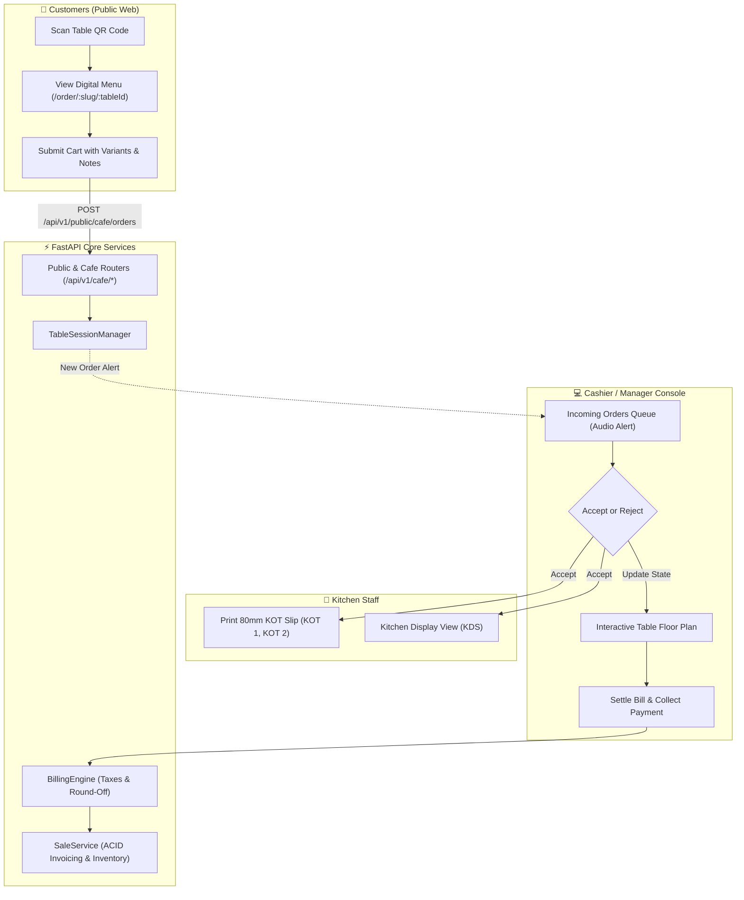

# QuickBill Café Persona — Architecture & Implementation Plan

Comprehensive implementation blueprint to introduce a dedicated **Café Persona** into QuickBill without regressing or modifying existing retail POS and multi-tenant billing functionality.

---

## User Review Required

> [!IMPORTANT]
> **Zero Code Modifications in Planning Mode**:
> In accordance with instructions, this is a planning-only phase. No application code, schemas, or configurations have been altered. Development begins only after review and explicit approval.

> [!WARNING]
> **Key Architecture Decisions for Approval**:
> 1. **Cashier Approval Gateway**: Public QR diner orders pause in a `SUBMITTED` state in the Cashier Queue and are only dispatched to the kitchen (`KOT`) upon staff acceptance. This blocks unauthorized remote or prank orders.
> 2. **Dedicated Collections vs. Staged Orders**: Introducing dedicated `tables`, `table_sessions`, and `kots` collections rather than overloading retail `staged_orders`.
> 3. **Physical Stock Audits before BOM Recipes**: Daily physical opening/closing stock audits will be delivered in Release 2 to measure real-world shrinkage. Automatic ingredient recipe (BOM) deductions are deferred to Release 4.

---

## Open Questions

> [!NOTE]
> Please review the following design decisions before development commences:
> 1. **Auto-Print KOT**: Should accepting an order immediately trigger the 80mm thermal print dialog, or appear silently on a tablet Kitchen Display Screen (KDS)? *(Recommendation: Configurable toggle `autoPrintKot`, defaulting to true).*
> 2. **Customer Order Cancellation**: Can diners cancel an order from their smartphone after submission? *(Recommendation: Only while in `SUBMITTED` state before cashier acceptance).*
> 3. **Discretionary Service Charge**: Should the billing engine support an optional 5–10% café service charge? *(Recommendation: Add optional `serviceChargePercent` in `cafeConfig`).*

---

## Proposed Changes



---

### Backend Components (`apps/api`)

#### [NEW] `apps/api/app/schemas/cafe.py`
- Pydantic models for Table CRUD (`TableCreate`, `TableUpdate`, `TableResponse`).
- Models for Table Sessions, Order Rounds, and KOT items (`TableSessionResponse`, `KOTResponse`).
- Models for Public Menu and Public Order submission (`PublicOrderSubmitRequest`, `PublicMenuResponse`).

#### [NEW] `apps/api/app/api/v1/cafe_tables.py`
- Endpoints:
  - `GET /api/v1/cafe/tables` (List tables with live statuses and order indicators)
  - `POST /api/v1/cafe/tables` (Create new dining table)
  - `PUT /api/v1/cafe/tables/{id}` (Update table label, capacity, section)
  - `PUT /api/v1/cafe/tables/{id}/status` (Update table status)
  - `DELETE /api/v1/cafe/tables/{id}` (Soft-delete / deactivate table)
  - `GET /api/v1/cafe/tables/{id}/qr` (Generate signed HMAC QR code URL)

#### [NEW] `apps/api/app/api/v1/cafe_sessions.py`
- Endpoints:
  - `GET /api/v1/cafe/sessions/active` (Polling endpoint for cashier queue & floor plan)
  - `POST /api/v1/cafe/sessions/{id}/orders/{orderId}/accept` (Dispatches KOT)
  - `POST /api/v1/cafe/sessions/{id}/orders/{orderId}/reject` (Rejects order)
  - `POST /api/v1/cafe/sessions/{id}/kot` (Punches direct waiter/cashier order)
  - `POST /api/v1/cafe/sessions/{id}/settle` (ACID transaction converting session into final invoice)

#### [NEW] `apps/api/app/api/v1/cafe_public.py`
- Endpoints:
  - `GET /api/v1/public/cafe/{businessSlug}/menu` (Cached read-only menu for diners)
  - `POST /api/v1/public/cafe/orders` (QR token-signed customer cart submission)
  - `GET /api/v1/public/cafe/orders/{orderId}/status` (Polling live preparation status)

#### [NEW] `apps/api/app/services/cafe_session_service.py`
- Core service managing table lifecycle, HMAC token verification, sequential KOT generation (`KOT-001`, `KOT-002`), and delta item extraction.

#### [NEW] `apps/api/app/api/v1/cafe_inventory.py` & `apps/api/app/schemas/cafe_inventory.py`
- Daily stock register:
  - `GET /api/v1/cafe/stock/today`
  - `POST /api/v1/cafe/stock/opening`
  - `POST /api/v1/cafe/stock/closing`
  - `GET /api/v1/cafe/stock/calendar`

#### [MODIFY] `apps/api/app/schemas/item.py` & `apps/api/app/api/v1/items.py`
- Add `itemType`: `"MENU_ITEM" | "RAW_MATERIAL" | "PACKAGING"`.
- Add `isCustomerVisible: bool`, `dietaryFlags`, `variants`, and `modifiers`.

#### [MODIFY] `apps/api/app/schemas/common.py` & `apps/api/app/api/v1/tenants.py`
- Add `settings.businessPersona` (`RETAIL` | `CAFE`) and `settings.cafeConfig`.

#### [MODIFY] `apps/api/app/main.py`
- Register new routers: `cafe_tables`, `cafe_sessions`, `cafe_public`, `cafe_inventory`.

---

### Web Frontend Components (`apps/web`)

#### [NEW] `apps/web/src/views/CafeDashboardView.tsx`
- Interactive floor plan grouped by section (Indoor, Patio, Balcony).
- Cards displaying table number, elapsed dining time, guest count, and current subtotal.

#### [NEW] `apps/web/src/views/TableManagementView.tsx`
- Grid for managing tables, editing sections, and exporting printable QR standee sheets.

#### [NEW] `apps/web/src/views/IncomingOrdersView.tsx`
- Real-time cashier queue displaying pending customer QR orders with audio chime alert.

#### [NEW] `apps/web/src/components/cafe/KOTPrintModal.tsx`
- Compact 80mm thermal kitchen ticket preview and print trigger.

#### [NEW] `apps/web/src/customer/DigitalMenuPage.tsx` & `CustomerCartDrawer.tsx`
- Mobile-responsive public web menu for diners scanning the table QR code.

#### [NEW] `apps/web/src/views/StockRegisterView.tsx` & `StockCalendarGrid.tsx`
- Daily opening/closing stock logging and monthly audit calendar.

#### [MODIFY] `apps/web/src/components/Sidebar.tsx` & `App.tsx`
- Conditionally render Café navigation links when store persona is set to `CAFE`.

#### [MODIFY] `apps/web/src/components/InvoicePrintModal.tsx`
- Add 1-click "Share via WhatsApp" button generating `https://wa.me/` URLs.

---

## Verification Plan

### Automated Tests
1. **Café MVP Suite (`apps/api/tests/test_cafe_mvp.py`)**:
   - Table CRUD and multi-tenant isolation.
   - HMAC QR token validation and anti-tamper tests.
   - Public menu item filtering (raw materials excluded).
   - Order submission $\rightarrow$ cashier acceptance $\rightarrow$ `KOT-001` creation.
   - Incremental ordering $\rightarrow$ `KOT-002` containing delta items only.
   - Table bill settlement $\rightarrow$ `sales_invoices` creation $\rightarrow$ stock decrement.
2. **Retail Regression Suite**:
   - Execute all existing test files: `test_billing_engine.py`, `test_staged_orders_api.py`, `test_inventory_and_supplier_ledger.py`, `test_multi_tenant_isolation.py`.
   - Ensure zero regressions.

```bash
# Backend test execution commands
pytest apps/api/tests/test_cafe_mvp.py -v
pytest apps/api/tests/test_billing_engine.py -v
pytest apps/api/tests/test_multi_tenant_isolation.py -v
```

### Manual Verification
1. **Persona Activation**: In Store Settings, change Persona to "Café" and verify that Café Dashboard appears in the sidebar.
2. **Table & Standee Export**: Add "Table T-01", click "Print Standee", and scan the generated QR code using a smartphone.
3. **Public Diner Ordering**: Add 2 Coffees with special notes on the phone, tap "Submit Order", and verify that the Web Cashier dashboard plays an alert chime.
4. **KOT Generation**: Click "Accept Order" as cashier; verify the 80mm KOT chit previews with table number, ticket number, and special notes.
5. **Round 2 Ordering**: Submit 1 Pastry from phone; verify Cashier receives incremental `KOT-002` with only the pastry.
6. **Settlement**: Click "Settle Table Bill", collect Cash payment, and verify that a final tax invoice is produced, stock is updated in inventory, and the table resets to `CLEANING`.
