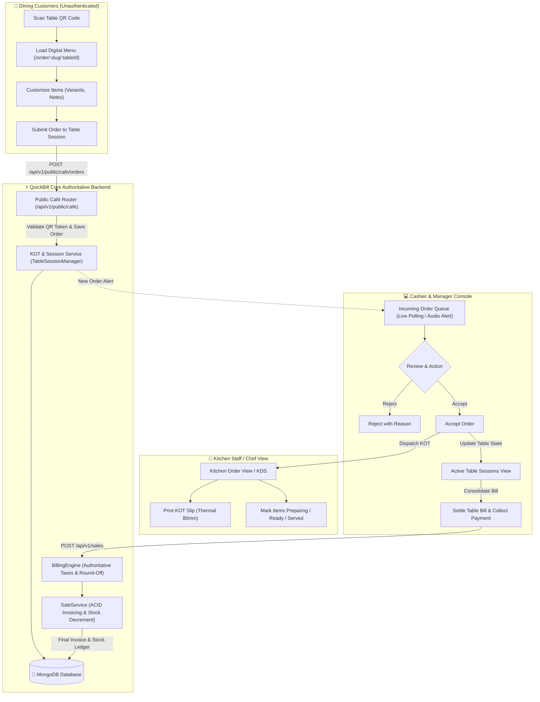
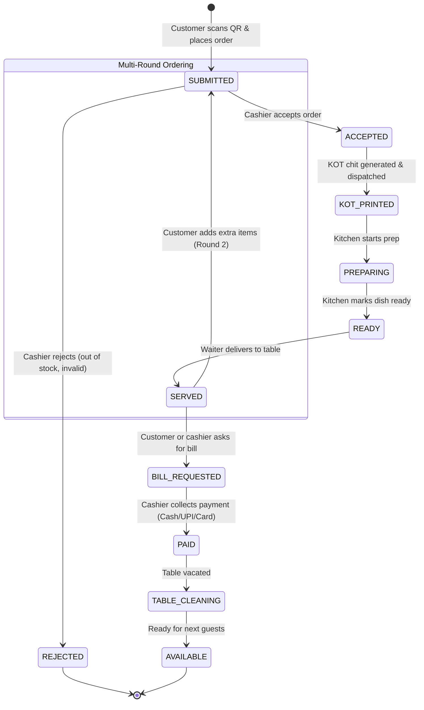
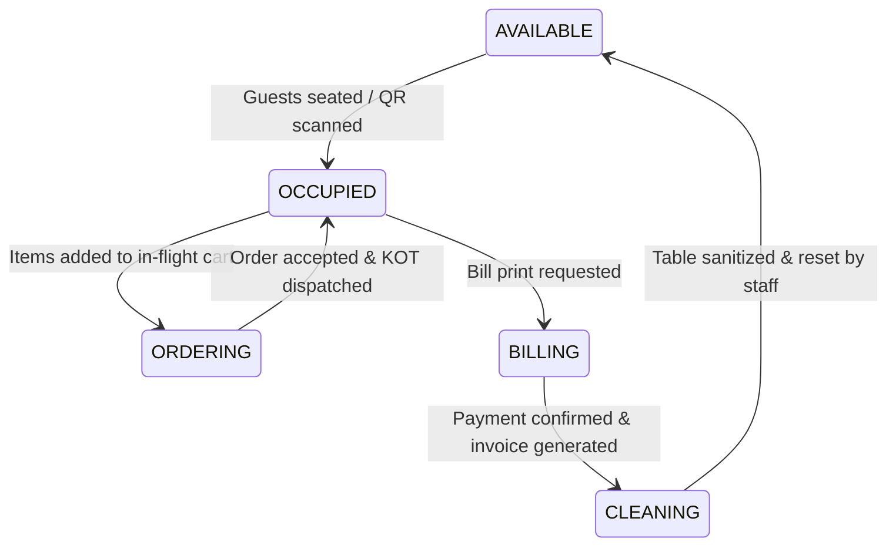

# QuickBill Café Persona — 03: Technical Architecture & System Design

## 1. Architectural Principles & Goals

1. **Zero Degradation of Existing Retail POS**: The existing retail and wholesale billing flows (`/pos`, `/inventory`, `/purchase-orders`, `/sales`) must remain completely operational and unaffected.
2. **Component & Logic Reuse**: Maximize reuse of authoritative services: `BillingEngine`, `SaleService`, `ItemRepository`, and `PurchaseOrderService`.
3. **Strict Tenancy & Zero Cross-Contamination**: Enforce logical tenant isolation by prefixing all queries with `{ businessId, locationId }`.
4. **Lightweight Dining Client**: The customer-facing digital menu and cart must load in $<1.5$ seconds on 4G smartphone browsers without requiring login, native app installation, or customer registration.
5. **Kitchen Ticket Separation**: Ensure strict separation between internal Kitchen Order Tickets (KOT) and legal tax invoices (`sales_invoices`).

---

## 2. End-to-End Café System Data Flow



---

## 3. Order Lifecycle State Machine



---

## 4. Table State Transitions

The `tables` collection documents will transition through five deterministic operational states:



| State | Color Token | Description | Trigger Event |
| :--- | :--- | :--- | :--- |
| **`AVAILABLE`** | Emerald (`#10b981`) | Table is vacant and sanitized. | Staff clicks "Mark Ready" or table reset. |
| **`OCCUPIED`** | Amber (`#f59e0b`) | Guests are seated; session active; food being served. | Cashier assigns table or guest scans QR. |
| **`ORDERING`** | Blue (`#3b82f6`) | Active incoming unconfirmed items in the queue. | Customer submits order from digital menu. |
| **`BILLING`** | Purple (`#8b5cf6`) | Bill print generated; awaiting payment collection. | Cashier clicks "Generate Table Bill". |
| **`CLEANING`** | Gray (`#6b7280`) | Guests departed; table requires bussing and wipe-down. | Payment successfully recorded. |

---

## 5. Component Architecture: New vs. Reusable Modules

### 5.1. Backend Architecture (`apps/api`)

```
apps/api/app/
├── api/v1/
│   ├── cafe_tables.py           # [NEW] Table CRUD, QR generation, status updates
│   ├── cafe_sessions.py         # [NEW] Table active sessions & KOT dispatcher
│   ├── cafe_public.py           # [NEW] Unauthenticated digital menu & customer order submission
│   ├── cafe_inventory.py        # [NEW] Daily opening/closing stock register & variance
│   ├── sales.py                 # [REUSED] Authoritative invoice generation
│   ├── items.py                 # [EXTENDED] Add itemType, variants, modifiers, recipe
│   ├── purchase_orders.py       # [REUSED] Raw material procurement & inwarding
│   └── staged_orders.py         # [REUSED] Background held carts
├── schemas/
│   ├── cafe.py                  # [NEW] Table, Session, KOT, and Digital Menu Pydantic models
│   ├── cafe_inventory.py        # [NEW] OpeningStock, ClosingStock, Variance models
│   └── item.py                  # [EXTENDED] Add ItemVariant, ItemModifier, itemType
└── services/
    ├── cafe_session_service.py  # [NEW] Table session management, KOT numbering & state
    ├── billing_engine.py        # [REUSED] Calculations (taxes, discounts, round-offs)
    └── sale_service.py          # [REUSED] Settlement into sales_invoices & stock decrement
```

### 5.2. Frontend Architecture (`apps/web`)

```
apps/web/src/
├── views/
│   ├── CafeDashboardView.tsx    # [NEW] Visual floor plan, active tables & quick metrics
│   ├── TableManagementView.tsx  # [NEW] Create/edit tables, sections, export QR cards
│   ├── IncomingOrdersView.tsx   # [NEW] Cashier incoming order review & audio alert
│   ├── KitchenOrdersView.tsx    # [NEW] Kitchen Display View (KDS) for chef staff
│   ├── StockRegisterView.tsx    # [NEW] Daily opening & closing stock entry & calendar
│   ├── PosBillingView.tsx       # [REUSED] Table checkout & counter walk-in sales
│   └── InventoryView.tsx        # [EXTENDED] Filter by raw materials vs menu items
├── components/cafe/
│   ├── TableCard.tsx            # [NEW] Table card with color badge, elapsed time, total
│   ├── KOTPrintModal.tsx        # [NEW] 80mm compact kitchen order ticket preview & print
│   ├── IncomingOrderCard.tsx    # [NEW] Accept/Reject incoming customer order card
│   └── StockCalendarGrid.tsx    # [NEW] Monthly audit calendar showing missing entries
└── customer/                     # [NEW] Customer-facing lightweight portal
    ├── DigitalMenuPage.tsx      # Public responsive menu (search, category tabs, veg tags)
    ├── CustomerCartDrawer.tsx   # Floating cart with item notes & variant pickers
    └── OrderConfirmation.tsx   # Live order tracking status (Submitted -> Accepted -> Ready)
```

---

## 6. Real-Time Synchronization Strategy

Real-time synchronization between the **Customer Digital Menu**, the **Cashier Incoming Queue**, and the **Kitchen Order View** is required to prevent missed orders.

### Strategy Evaluation:
1. **WebSockets (`/ws`)**: High performance, bidirectional, but introduces complex connection management behind serverless proxies (e.g., Vercel / Netlify edge timeouts).
2. **Short-Interval Smart Polling (Selected for MVP)**:
   - Cashier Queue and Kitchen Views poll `/api/v1/cafe/sessions/active` every **4 to 6 seconds** with `If-Modified-Since` or `lastTimestamp` delta parameters.
   - Low operational overhead, zero WebSocket disconnect reconnect complexity, 100% serverless/docker friendly.
   - Audio chime (`playAudioAlert()`) triggers in browser whenever incoming order count increments.
3. **Server-Sent Events (SSE) (Release 3 Roadmap)**:
   - One-way real-time push from FastAPI to Web Cashier and Kitchen consoles without full duplex WebSockets.

---

## 7. Public Customer Security & Anti-Abuse Guard

To allow walk-in diners to order from table QR codes without exposing the API to remote spammers:

1. **Cryptographic QR Signing**:
   The table QR code encodes a signed URL:
   `https://app.quickbill.com/order/{tenantSlug}/{tableId}?token={hmacToken}`
   The HMAC token is computed as:
   $$\text{Token} = \text{HMAC-SHA256}(\text{Secret}, \text{businessId} + \text{tableId} + \text{salt})$$
2. **Session Lifespan & Daily Salt**:
   The salt rotates daily or can be regenerated instantly by the cashier if a table code is abused.
3. **Cashier Approval Gateway**:
   Orders placed via public QR codes enter the `SUBMITTED` state in the `IncomingOrders` queue. **No KOT is dispatched to the kitchen and no food is prepared until a cashier clicks "Accept".** This neutralizes remote or prank orders.
4. **Rate Limiting**:
   Public endpoints are throttled using in-memory / Redis sliding window (maximum 10 orders per IP per 5 minutes).

