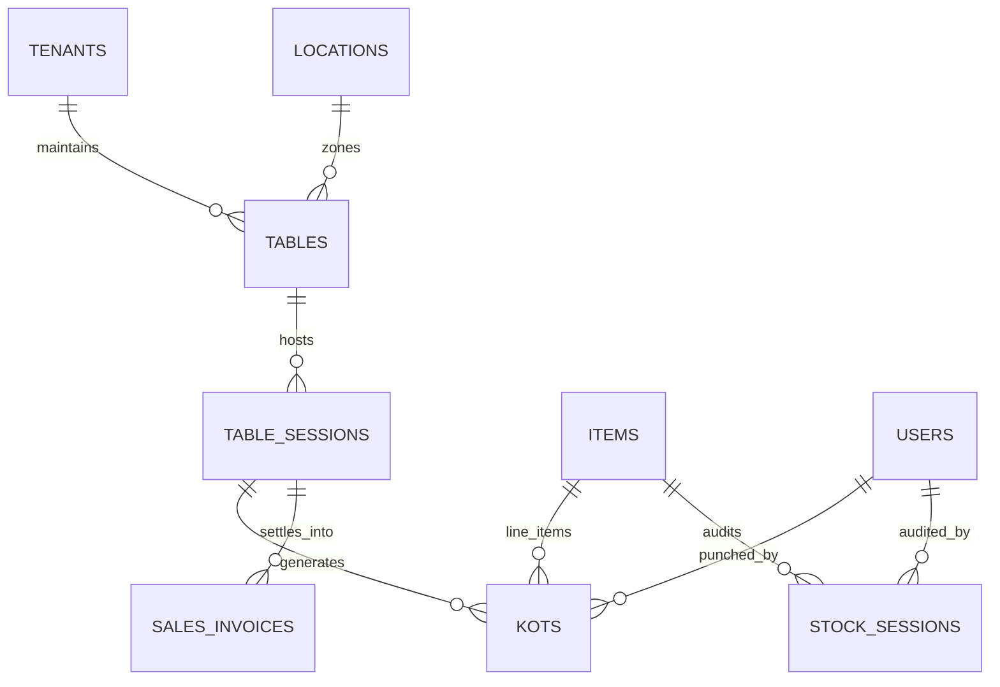

# QuickBill Café Persona — 04: Database Schemas & API Contracts

## 1. Database Architecture & New Collections

All café collections reside inside the tenant's database (either the shared `quickbill_db` filtered by `businessId` or dedicated tenant database).



---

## 2. MongoDB Schema Specifications

### 2.1. `tenants.settings` (Schema Extension)
To support persona configuration without modifying core tenant structure:

```json
{
  "settings": {
    "businessPersona": "CAFE", // "RETAIL" | "CAFE" | "HYBRID"
    "cafeConfig": {
      "enableQrOrdering": true,
      "requireOrderApproval": true,
      "autoPrintKot": true,
      "kotPrinterType": "THERMAL_80MM",
      "allowCustomerOrderCancellation": false,
      "serviceChargePercent": 0.0,
      "sections": ["Indoor AC", "Outdoor Patio", "First Floor", "Bar Counter"]
    }
  }
}
```

---

### 2.2. `tables` Collection
Represents physical dining tables or seating stations.

```json
{
  "_id": { "$oid": "6601a1b9a000000000000101" },
  "businessId": { "$oid": "65f2a1b9a000000000000001" },
  "locationId": "65f2a1b9a000000000000101",
  "tableNumber": "T-04",
  "label": "Table 4",
  "section": "Indoor AC",
  "seatingCapacity": 4,
  "currentStatus": "OCCUPIED", // AVAILABLE | OCCUPIED | ORDERING | BILLING | CLEANING
  "activeSessionId": { "$oid": "6601a1b9a000000000000201" },
  "qrCodeSecret": "sec_8842af91c2",
  "qrCodeUrl": "https://quickbill.app/order/main-store-01/T-04?token=a8f902c...",
  "isActive": true,
  "createdAt": { "$date": "2026-03-25T10:00:00.000Z" },
  "updatedAt": { "$date": "2026-03-25T12:30:00.000Z" }
}
```

**Required Compound Indexes:**
- `{ businessId: 1, locationId: 1, tableNumber: 1 }` (Unique constraint)
- `{ businessId: 1, locationId: 1, currentStatus: 1 }`

---

### 2.3. `table_sessions` Collection
Maintains the running tab for a table from party seating until final payment.

```json
{
  "_id": { "$oid": "6601a1b9a000000000000201" },
  "businessId": { "$oid": "65f2a1b9a000000000000001" },
  "locationId": "65f2a1b9a000000000000101",
  "tableId": { "$oid": "6601a1b9a000000000000101" },
  "tableNumber": "T-04",
  "sessionStatus": "ACTIVE", // ACTIVE | BILLING | SETTLED | CANCELLED
  "guestCount": 3,
  "customerName": "Rohan Sharma",
  "customerPhone": "+91 9876543210",
  "customerId": { "$oid": "65f2a1b9a000000000000502" },
  "orders": [
    {
      "orderId": "ord_round_1",
      "source": "QR_CUSTOMER", // QR_CUSTOMER | CASHIER_POS | WAITER_APP
      "placedAt": { "$date": "2026-03-25T12:00:00.000Z" },
      "approvalStatus": "ACCEPTED", // SUBMITTED | ACCEPTED | REJECTED | CANCELLED
      "kotId": { "$oid": "6601a1b9a000000000000301" },
      "kotNumber": "KOT-001",
      "items": [
        {
          "itemId": "65f2a1b9a000000000000201",
          "nameSnapshot": "Cappuccino",
          "variantName": "Large",
          "unitPrice": 160.00,
          "quantity": 2.0,
          "notes": "Extra hot, oat milk",
          "taxRate": 5.0,
          "lineTotal": 320.00
        }
      ]
    }
  ],
  "sessionSubtotal": 304.76,
  "sessionTaxTotal": 15.24,
  "sessionGrandTotal": 320.00,
  "settledInvoiceId": null,
  "openedAt": { "$date": "2026-03-25T11:55:00.000Z" },
  "closedAt": null
}
```

**Required Compound Indexes:**
- `{ businessId: 1, tableId: 1, sessionStatus: 1 }`
- `{ businessId: 1, locationId: 1, openedAt: -1 }`

---

### 2.4. `kots` (Kitchen Order Tickets) Collection
Represents individual printed/dispatched slips sent to the kitchen.

```json
{
  "_id": { "$oid": "6601a1b9a000000000000301" },
  "businessId": { "$oid": "65f2a1b9a000000000000001" },
  "locationId": "65f2a1b9a000000000000101",
  "kotNumber": "KOT-001",
  "sessionId": { "$oid": "6601a1b9a000000000000201" },
  "tableNumber": "T-04",
  "serverName": "Cashier Amit",
  "orderSource": "QR_CUSTOMER",
  "roundNumber": 1,
  "kitchenStatus": "PREPARING", // QUEUED | PREPARING | READY | SERVED
  "items": [
    {
      "itemId": "65f2a1b9a000000000000201",
      "name": "Cappuccino (Large)",
      "quantity": 2.0,
      "notes": "Extra hot, oat milk"
    }
  ],
  "isPrinted": true,
  "printedAt": { "$date": "2026-03-25T12:02:00.000Z" },
  "createdAt": { "$date": "2026-03-25T12:01:00.000Z" }
}
```

---

### 2.5. `items` (Schema Extensions for Menu & Raw Materials)
Extends the existing `items` collection in `apps/api/app/schemas/item.py`:

```json
{
  "itemType": "MENU_ITEM", // "MENU_ITEM" | "RAW_MATERIAL" | "PACKAGING"
  "isCustomerVisible": true, // Hide raw materials from customer digital menu
  "dietaryFlags": {
    "isVeg": true,
    "isVegan": false,
    "isEgg": false,
    "isGlutenFree": true,
    "spicinessLevel": 0 // 0: None, 1: Mild, 2: Medium, 3: Hot
  },
  "preparationTimeMinutes": 8,
  "variants": [
    { "variantId": "var_reg", "name": "Regular", "salePrice": 120.00 },
    { "variantId": "var_lge", "name": "Large", "salePrice": 160.00 }
  ],
  "modifiers": [
    { "modifierId": "mod_oat", "name": "Oat Milk", "additionalPrice": 30.00 },
    { "modifierId": "mod_sht", "name": "Extra Espresso Shot", "additionalPrice": 40.00 }
  ]
}
```

---

### 2.6. `stock_sessions` (Daily Opening/Closing Register)
Records daily physical stock audit counts for café raw materials.

```json
{
  "_id": { "$oid": "6601a1b9a000000000000401" },
  "businessId": { "$oid": "65f2a1b9a000000000000001" },
  "locationId": "65f2a1b9a000000000000101",
  "auditDate": "2026-03-25",
  "status": "COMPLETED", // OPEN_PENDING | OPEN_LOGGED | CLOSED_AUDITED | COMPLETED
  "openingRecordedBy": "usr_morning_chef",
  "openingRecordedAt": { "$date": "2026-03-25T07:30:00.000Z" },
  "closingRecordedBy": "usr_night_manager",
  "closingRecordedAt": { "$date": "2026-03-25T23:00:00.000Z" },
  "entries": [
    {
      "itemId": "65f2a1b9a000000000000210",
      "itemName": "Whole Milk (Fresh)",
      "sku": "RAW-MLK-01",
      "unit": "ltr",
      "openingStock": 20.0,
      "inwardPurchases": 15.0,
      "systemClosingEstimated": 12.0,
      "physicalClosingStock": 10.5,
      "variance": -1.5,
      "varianceCost": 90.00,
      "reason": "Spoilage & steam pitcher waste"
    }
  ],
  "notes": "Higher milk waste due to steam wand calibration"
}
```

**Required Compound Indexes:**
- `{ businessId: 1, locationId: 1, auditDate: -1 }` (Unique constraint)

---

## 3. Authoritative API Specifications

### 3.1. Table Management APIs

| Method | Endpoint | Auth Guard | Description |
| :--- | :--- | :--- | :--- |
| `GET` | `/api/v1/cafe/tables` | Manager / Cashier | List tables for active location with live statuses and order count |
| `POST` | `/api/v1/cafe/tables` | Tenant Admin / Manager | Create new table (tableNumber, capacity, section) |
| `PUT` | `/api/v1/cafe/tables/{id}` | Tenant Admin / Manager | Update table details or section |
| `PUT` | `/api/v1/cafe/tables/{id}/status` | Cashier / Waiter | Update table state (`AVAILABLE`, `CLEANING`, etc.) |
| `DELETE` | `/api/v1/cafe/tables/{id}` | Tenant Admin / Manager | Soft-delete / deactivate table |
| `GET` | `/api/v1/cafe/tables/{id}/qr` | Cashier / Manager | Generate signed QR code URL and PNG image |

---

### 3.2. Order & Session APIs

| Method | Endpoint | Auth Guard | Description |
| :--- | :--- | :--- | :--- |
| `GET` | `/api/v1/cafe/sessions/active` | Cashier / Manager | Polling endpoint for active table sessions & incoming queue |
| `POST` | `/api/v1/cafe/sessions/{id}/orders/{orderId}/accept` | Cashier / Manager | Accepts incoming order $\rightarrow$ dispatches KOT |
| `POST` | `/api/v1/cafe/sessions/{id}/orders/{orderId}/reject` | Cashier / Manager | Rejects incoming order with cancellation reason |
| `POST` | `/api/v1/cafe/sessions/{id}/kot` | Cashier / Waiter | Cashier punches order directly $\rightarrow$ dispatches KOT |
| `POST` | `/api/v1/cafe/sessions/{id}/settle` | Cashier | Consolidates all session KOTs into final `sales_invoices` record |

---

### 3.3. Public Customer QR APIs (Unauthenticated)

| Method | Endpoint | Auth Guard | Description |
| :--- | :--- | :--- | :--- |
| `GET` | `/api/v1/public/cafe/{businessSlug}/menu` | Public (Cached) | Fetch café digital menu items (only `isCustomerVisible: true`) |
| `POST` | `/api/v1/public/cafe/orders` | Signed QR Token | Customer submits cart with variants and table association |
| `GET` | `/api/v1/public/cafe/orders/{orderId}/status` | Public / Token | Polling live order status (`SUBMITTED` $\rightarrow$ `ACCEPTED` $\rightarrow$ `PREPARING`) |

---

### 3.4. Daily Stock Register APIs

| Method | Endpoint | Auth Guard | Description |
| :--- | :--- | :--- | :--- |
| `GET` | `/api/v1/cafe/stock/today` | Manager / Cashier | Get or initialize today's opening/closing stock register |
| `POST` | `/api/v1/cafe/stock/opening` | Manager / Cashier | Save morning opening stock entries (auto carries forward if blank) |
| `POST` | `/api/v1/cafe/stock/closing` | Manager | Save night closing physical count $\rightarrow$ calculates variance |
| `GET` | `/api/v1/cafe/stock/calendar` | Manager / Admin | Monthly audit grid showing days with completed vs missing entries |

---

## 4. Multi-Document ACID Transaction Boundaries

When settling a table bill via `POST /api/v1/cafe/sessions/{id}/settle`:

```python
async with await client.start_session() as session:
    async with session.start_transaction():
        # 1. Verify table session is active
        # 2. Run BillingEngine.calculate on all accepted order items
        # 3. Insert sales_invoices record
        # 4. Insert inventory_movements records (stock decrement)
        # 5. Update items.currentStock & location stock
        # 6. If credit, update parties.currentBalance
        # 7. Update table_sessions: status = SETTLED, closedAt = now
        # 8. Update tables: currentStatus = CLEANING, activeSessionId = null
```
This guarantees atomicity: it is impossible for a bill to be generated without releasing the table session and recording stock ledger entries.

