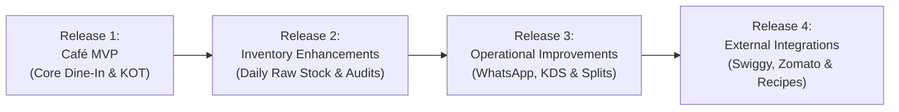

# QuickBill Café Persona — 06: Implementation Roadmap & Release Plan

## 1. Release Strategy Overview

To guarantee zero regressions for existing retail tenants while delivering rapid value to food & beverage businesses, the Café Persona is structured into **four sequential releases**:

---

## 2. Release 1 – Café MVP (Core Dine-In, QR & Kitchen Tickets)

### Focus
Enable a café to configure tables, generate QR codes, allow customers to view the digital menu and submit orders, let cashiers accept orders and dispatch KOTs to the kitchen, and consolidate round-based orders into final tax invoices.

### Tasks & Work Breakdown

| Task ID | Task Title | Modules Affected | Estimated Effort |
| :--- | :--- | :--- | :--- |
| **R1-BE-01** | Persona Tenant Configuration | `apps/api/app/schemas/common.py`, `tenants.py` | 0.5 Days |
| **R1-BE-02** | Table Collection & CRUD Endpoints | `apps/api/app/api/v1/cafe_tables.py`, `schemas/cafe.py` | 1.0 Day |
| **R1-BE-03** | Cryptographic QR Code Generation | `apps/api/app/services/cafe_session_service.py` | 0.5 Days |
| **R1-BE-04** | Public Menu & Customer Order API | `apps/api/app/api/v1/cafe_public.py` | 1.5 Days |
| **R1-BE-05** | Table Session & Incremental KOT Engine | `apps/api/app/services/cafe_session_service.py` | 2.0 Days |
| **R1-BE-06** | Table Bill Consolidation & Settlement | `apps/api/app/api/v1/cafe_sessions.py`, `sale_service.py` | 1.0 Day |
| **R1-FE-01** | Web Sidebar & Persona View Switcher | `apps/web/src/components/Sidebar.tsx`, `Header.tsx` | 0.5 Days |
| **R1-FE-02** | Café Dashboard & Live Floor Plan | `apps/web/src/views/CafeDashboardView.tsx`, `TableCard.tsx` | 2.0 Days |
| **R1-FE-03** | Table Management & QR Code Standees | `apps/web/src/views/TableManagementView.tsx` | 1.0 Day |
| **R1-FE-04** | Incoming Orders Review Queue & Audio Chime | `apps/web/src/views/IncomingOrdersView.tsx` | 1.0 Day |
| **R1-FE-05** | Thermal 80mm KOT Chit Preview & Print Modal | `apps/web/src/components/cafe/KOTPrintModal.tsx` | 1.0 Day |
| **R1-FE-06** | Mobile Customer Digital Menu & Cart Web Page | `apps/web/src/customer/DigitalMenuPage.tsx` | 2.5 Days |
| **R1-QA-01** | End-to-End Test Suite for Café MVP | `apps/api/tests/test_cafe_mvp.py` | 1.5 Days |

**Total Release 1 Estimate**: **16 Engineering Days**

### Dependencies
- Existing `BillingEngine` (`apps/api/app/services/billing_engine.py`).
- Existing `SaleService` (`apps/api/app/services/sale_service.py`).
- MongoDB `tables`, `table_sessions`, and `kots` collections.

### Acceptance Criteria
1. Switching tenant persona to `CAFE` in store settings activates the Café Dashboard and table routes without affecting retail tenants.
2. Creating a table generates a unique QR code containing an HMAC-signed public link.
3. Scanning the QR code on a smartphone loads the café menu in $<1.5$s with item search and veg/non-veg tags.
4. Customer cart submission immediately alerts the cashier queue with an audio chime.
5. Cashier accepting the order creates `KOT-001` and opens the 80mm kitchen print chit.
6. Subsequent order rounds generate `KOT-002` without duplicating previously prepared items.
7. Settle Bill aggregates all rounds into an authoritative invoice, collects payment, and transitions table state to `CLEANING`.

---

## 3. Release 2 – Inventory Enhancements (Raw Materials & Stock Register)

### Focus
Classify inventory into raw materials vs. sellable menu items, implement daily opening/closing stock verification, carry forward balances, and provide an audit grid.

### Tasks & Work Breakdown

| Task ID | Task Title | Modules Affected | Estimated Effort |
| :--- | :--- | :--- | :--- |
| **R2-BE-01** | Item Classification (`itemType`, visibility) | `apps/api/app/schemas/item.py`, `items.py` | 1.0 Day |
| **R2-BE-02** | Stock Sessions Collection & Endpoints | `apps/api/app/api/v1/cafe_inventory.py` | 1.5 Days |
| **R2-BE-03** | Automated Closing-to-Opening Carry-Forward | `apps/api/app/services/stock_session_service.py` | 1.0 Day |
| **R2-BE-04** | Consumption & Variance Calculation | `apps/api/app/api/v1/cafe_inventory.py` | 1.0 Day |
| **R2-FE-01** | Raw Material Catalog UI & Hide from Menu | `apps/web/src/views/InventoryView.tsx` | 1.0 Day |
| **R2-FE-02** | Daily Stock Register Entry Screen | `apps/web/src/views/StockRegisterView.tsx` | 2.0 Days |
| **R2-FE-03** | Monthly Audit Calendar & Missing Indicators | `apps/web/src/components/cafe/StockCalendarGrid.tsx` | 1.5 Days |
| **R2-QA-01** | Inventory & Stock Register Test Suite | `apps/api/tests/test_cafe_inventory.py` | 1.0 Day |

**Total Release 2 Estimate**: **10 Engineering Days**

### Dependencies
- Release 1 completed.
- Existing `inventory_movements` ledger and `purchase_orders` inwarding.

### Acceptance Criteria
1. Items marked `RAW_MATERIAL` do not appear on the customer digital menu.
2. Morning opening stock defaults to yesterday's closing count, with manual override capability.
3. Evening physical closing count calculates exact consumption and variance loss.
4. Calendar grid clearly flags days where closing counts were omitted.

---

## 4. Release 3 – Operational Improvements (WhatsApp, Splits & KDS)

### Focus
One-click WhatsApp invoice dispatch on web, table bill splitting, paperless Kitchen Display View (KDS), and cancellation workflows.

### Tasks & Work Breakdown

| Task ID | Task Title | Modules Affected | Estimated Effort |
| :--- | :--- | :--- | :--- |
| **R3-FE-01** | Web WhatsApp 1-Click Invoice Share Button | `apps/web/src/components/InvoicePrintModal.tsx` | 0.5 Days |
| **R3-FE-02** | Kitchen Display View (KDS) Live Web Console | `apps/web/src/views/KitchenOrdersView.tsx` | 2.0 Days |
| **R3-BE-01** | Table Bill Splitting (Equal & Custom Splits) | `apps/api/app/services/cafe_session_service.py` | 1.5 Days |
| **R3-FE-03** | Split Bill Settlement Modal | `apps/web/src/views/PosBillingView.tsx` | 1.5 Days |
| **R3-BE-02** | Item Cancellation & Spoilage Audit Trail | `apps/api/app/api/v1/cafe_sessions.py` | 1.0 Day |
| **R3-FE-04** | Café Sales & Table Turnover Analytics | `apps/web/src/views/ReportsView.tsx` | 1.5 Days |

**Total Release 3 Estimate**: **8 Engineering Days**

### Dependencies
- Release 1 & Release 2 completed.

### Acceptance Criteria
1. Clicking "Share via WhatsApp" on Web opens `https://wa.me/` with formatted receipt details and download link.
2. Kitchen staff can mark dishes "Ready" on tablet screen without paper chits.
3. Tables can split bills evenly among guests with separate payment receipts.

---

## 5. Release 4 – External Integrations (Swiggy, Zomato & Recipes)

### Focus
Swiggy/Zomato aggregator order ingestion, table reservations, and automatic Bill of Materials (BOM) stock depletion.

### Tasks & Work Breakdown

| Task ID | Task Title | Modules Affected | Estimated Effort |
| :--- | :--- | :--- | :--- |
| **R4-INT-01** | Swiggy / Zomato Partner Webhook Ingestion | `apps/api/app/api/v1/integrations/aggregators.py` | 3.0 Days |
| **R4-INT-02** | External Order Duplicate Guard & Auto-KOT | `apps/api/app/services/aggregator_sync_service.py` | 2.0 Days |
| **R4-INT-03** | Bill of Materials (BOM) Recipe Engine | `apps/api/app/services/recipe_engine.py` | 3.5 Days |
| **R4-INT-04** | Table Reservations & Deposit Booking | `apps/api/app/api/v1/cafe_reservations.py` | 2.5 Days |

**Total Release 4 Estimate**: **11 Engineering Days** *(Subject to external API approval)*

### Dependencies
- Official Zomato & Swiggy Merchant API credentials and developer access approvals.

